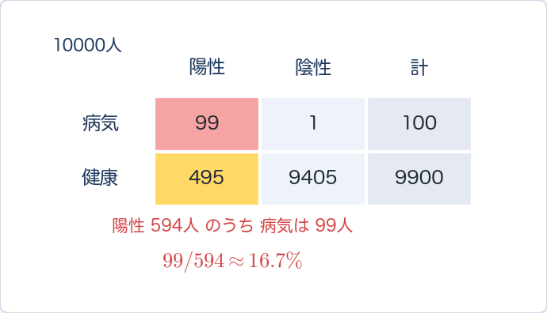
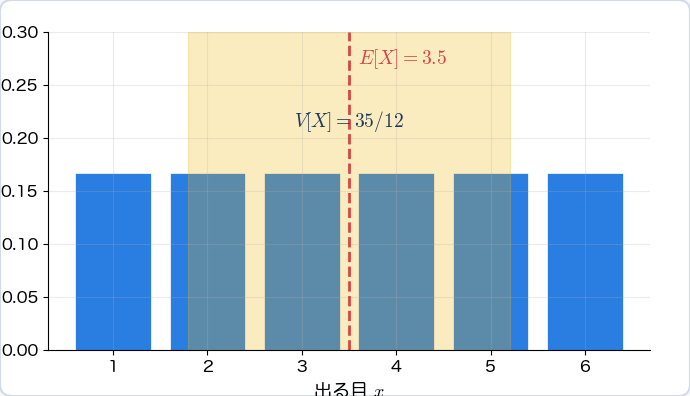
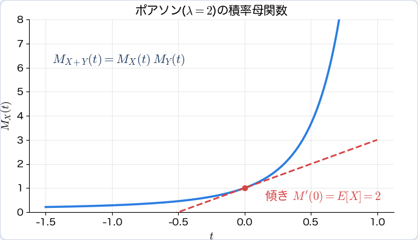
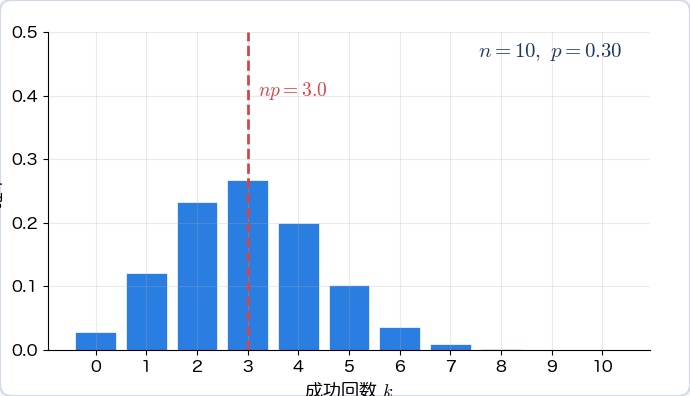
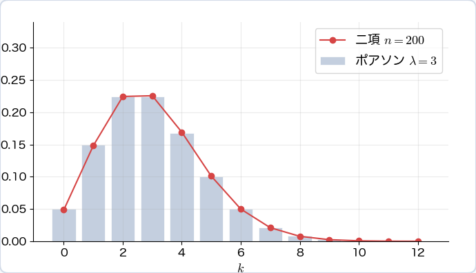
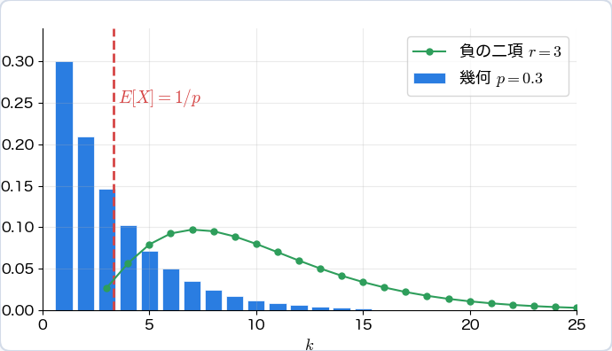
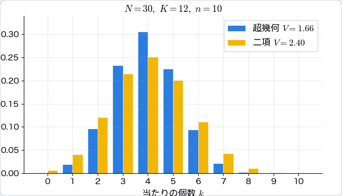
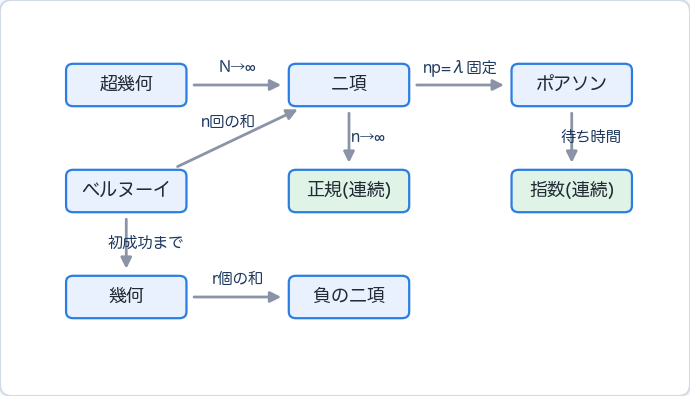

# 第1回　確率の基礎と離散分布

> **この回の学習目標**
>
> - 条件付き確率・ベイズの定理を使って「結果から原因の確率」を計算できる
> - 期待値・分散の性質と、積率母関数（モーメント母関数）の使い方を説明できる
> - 二項・ポアソン・幾何・負の二項・超幾何分布の期待値・分散・相互関係を押さえる

## 1. 条件付き確率とベイズの定理

**条件付き確率** は、事象 $B$ が起きたという条件のもとでの $A$ の確率です。

$$P(A\mid B)=\frac{P(A\cap B)}{P(B)}\qquad (P(B)>0)$$

$P(A\cap B)=P(A)P(B)$ のとき $A,B$ は **独立** で、このとき $P(A\mid B)=P(A)$ です。

事象 $A_1,\dots,A_k$ が互いに排反で全体を覆う（分割）とき、**全確率の公式** と **ベイズの定理** が成り立ちます。

$$P(B)=\sum_{i}P(B\mid A_i)P(A_i),\qquad P(A_i\mid B)=\frac{P(B\mid A_i)P(A_i)}{\sum_{j}P(B\mid A_j)P(A_j)}$$

ベイズの定理は「原因 $A_i$ → 結果 $B$」の確率から、「結果 $B$ → 原因 $A_i$」の確率へ **条件の向きを入れ替える** 公式です。後の「ベイズ統計」（第11回）の出発点になります。

### 例：検査の陽性的中率

有病率 1%、病気の人の 99% が陽性、健康な人でも 5% が陽性になる検査を 10000 人に行うと、人数は次の表になります。

| | 陽性 | 陰性 | 計 |
|---|---|---|---|
| 病気 | 99 | 1 | 100 |
| 健康 | 495 | 9405 | 9900 |

陽性は $99+495=594$ 人で、そのうち本当に病気なのは $99/594\approx16.7\%$ です。感度が高くても、**有病率が低いと陽性者の大半は偽陽性** になります。

> **試験のポイント**　「表（頻度）に直して数える」と、ベイズの定理の分母・分子の取り違えを防げます。

## 2. 期待値と分散

離散確率変数 $X$ の期待値・分散は

$$E[X]=\sum_x x\,P(X=x),\qquad V[X]=E\big[(X-E[X])^2\big]=E[X^2]-(E[X])^2$$

です。**後者の形（二乗の期待値 − 期待値の二乗）が計算に便利** です。

**性質（線形性）**

- $E[aX+b]=aE[X]+b$（独立でなくても $E[X+Y]=E[X]+E[Y]$）
- $V[aX+b]=a^2V[X]$（定数 $b$ を足しても分散は変わらない）
- $V[X+Y]=V[X]+V[Y]+2\,\mathrm{Cov}(X,Y)$。**独立なら共分散が 0** なので $V[X+Y]=V[X]+V[Y]$

### 例：サイコロ

$E[X]=\frac{1+2+\cdots+6}{6}=3.5$、$E[X^2]=\frac{1+4+9+16+25+36}{6}=\frac{91}{6}$ なので

$$V[X]=\frac{91}{6}-\left(\frac{7}{2}\right)^2=\frac{182-147}{12}=\frac{35}{12}\approx2.92$$

## 3. 積率母関数（モーメント母関数）

**積率母関数** は

$$M_X(t)=E\big[e^{tX}\big]$$

で定義されます（$t=0$ の近くで存在するとき）。

**性質**

1. $M_X(0)=1$
2. $\displaystyle E[X^k]=M_X^{(k)}(0)$（$t$ で $k$ 回微分して $t=0$ を代入するとモーメントが得られる）
3. $X,Y$ が独立なら $M_{X+Y}(t)=M_X(t)M_Y(t)$（**和の分布が「積」で扱える**）
4. 積率母関数が一致すれば分布も一致する（一意性）

なぜ 2 が成り立つか：$e^{tX}=\sum_k \frac{t^kX^k}{k!}$ なので $M_X(t)=\sum_k \frac{E[X^k]}{k!}t^k$。係数を比べると $E[X^k]$ が得られます。

### 例：ポアソン分布

$M(t)=\sum_{k}e^{tk}\frac{e^{-\lambda}\lambda^k}{k!}=e^{-\lambda}\sum_k\frac{(\lambda e^t)^k}{k!}=\exp\{\lambda(e^t-1)\}$

$M'(t)=\lambda e^t M(t)$ より $M'(0)=\lambda$。$M''(0)=\lambda+\lambda^2$ なので $V[X]=\lambda+\lambda^2-\lambda^2=\lambda$。

> **試験のポイント**　「独立な確率変数の和の分布を求めよ」は、**積率母関数の積 → 形から分布を同定** が定番の解き方です。

## 4. 二項分布

成功確率 $p$ のベルヌーイ試行を $n$ 回行ったときの成功回数 $X\sim B(n,p)$：

$$P(X=k)=\binom{n}{k}p^k(1-p)^{n-k}\quad(k=0,\dots,n)$$

$X=Y_1+\cdots+Y_n$（$Y_i$ は独立なベルヌーイ）と書けるので

$$E[X]=np,\qquad V[X]=np(1-p),\qquad M(t)=(1-p+pe^t)^n$$

**再生性**：独立な $X_1\sim B(n_1,p)$, $X_2\sim B(n_2,p)$ の和は $B(n_1+n_2,p)$（積率母関数の積から分かる。**成功確率 $p$ が同じ** ことが条件）。

$p$ が小さいと右に裾が長く、$p=0.5$ で左右対称、$p$ が大きいと左に裾が長くなります。

## 5. ポアソン分布

一定の時間・空間に起きる稀な事象の回数のモデルで、$X\sim Po(\lambda)$：

$$P(X=k)=\frac{e^{-\lambda}\lambda^k}{k!}\quad(k=0,1,2,\dots),\qquad E[X]=V[X]=\lambda$$

**二項分布の極限としての導出**：$np=\lambda$ を固定して $n\to\infty$（$p=\lambda/n\to0$）とすると

$$\binom{n}{k}\left(\frac{\lambda}{n}\right)^k\left(1-\frac{\lambda}{n}\right)^{n-k}\to\frac{\lambda^k}{k!}e^{-\lambda}$$

**加法性**：独立なポアソン $Po(\lambda_1)$, $Po(\lambda_2)$ の和は $Po(\lambda_1+\lambda_2)$。

**時間の扱い**：1時間あたり平均 $\lambda$ 件なら、$t$ 時間では $Po(\lambda t)$ です（演習2）。

> **試験のポイント**　「平均と分散が等しい」はポアソン分布の目印です（後の過分散の話につながります）。

## 6. 幾何分布と負の二項分布

### 幾何分布

成功確率 $p$ の試行を繰り返し、**初めて成功するまでの試行回数** $X$：

$$P(X=k)=(1-p)^{k-1}p\ (k=1,2,\dots),\qquad E[X]=\frac1p,\quad V[X]=\frac{1-p}{p^2}$$

生存関数は $P(X>k)=(1-p)^k$（最初の $k$ 回が全部失敗）。

**無記憶性**：

$$P(X>m+n\mid X>m)=\frac{(1-p)^{m+n}}{(1-p)^m}=(1-p)^n=P(X>n)$$

過去に何回失敗していても、残りの待ち回数の分布は最初と同じです。

### 負の二項分布

**$r$ 回成功するまでの試行回数** $X$：

$$P(X=k)=\binom{k-1}{r-1}p^r(1-p)^{k-r}\ (k\ge r),\qquad E[X]=\frac{r}{p},\ V[X]=\frac{r(1-p)}{p^2}$$

幾何分布 $r$ 個（独立）の和です。**「失敗回数」を数える流儀もある** ので、問題文の定義を必ず確認します。

## 7. 超幾何分布

当たりが $K$ 個ある $N$ 個の中から **非復元で** $n$ 個取り出したときの当たりの個数 $X$：

$$P(X=k)=\frac{\binom{K}{k}\binom{N-K}{n-k}}{\binom{N}{n}},\qquad E[X]=n\frac{K}{N},\quad V[X]=n\frac{K}{N}\Big(1-\frac{K}{N}\Big)\frac{N-n}{N-1}$$

二項分布（復元抽出）との違いは分散の **有限修正** $\frac{N-n}{N-1}$ だけで、$N$ が大きければ二項分布 $B(n,K/N)$ で近似できます。この係数は第14回の標本調査法にもそのまま現れます。

## 8. 離散分布のまとめ

| 分布 | 確率関数の意味 | 期待値 | 分散 |
|---|---|---|---|
| 二項 $B(n,p)$ | $n$ 回中の成功回数 | $np$ | $np(1-p)$ |
| ポアソン $Po(\lambda)$ | 稀な事象の回数 | $\lambda$ | $\lambda$ |
| 幾何 | 初成功までの回数 | $1/p$ | $(1-p)/p^2$ |
| 負の二項 | $r$ 回成功までの回数 | $r/p$ | $r(1-p)/p^2$ |
| 超幾何 | 非復元抽出での当たり数 | $nK/N$ | $n\frac{K}{N}(1-\frac{K}{N})\frac{N-n}{N-1}$ |

関係：ベルヌーイ → 二項（$n$ 個の和）→ ポアソン（$np=\lambda$ 固定で $n\to\infty$）／正規（$n\to\infty$）、超幾何 → 二項（$N\to\infty$）、幾何 → 負の二項（$r$ 個の和）。

## 演習問題

### 演習1　ベイズの定理

**問題**　ある病気の有病率は 2%。検査は、病気の人の 90% が陽性、健康な人の 5% が陽性になる。陽性と出たとき、本当に病気である確率を求めよ。

**解答**　「病気」を $D$、「陽性」を $+$ とする。

$$P(D\mid +)=\frac{P(+\mid D)P(D)}{P(+\mid D)P(D)+P(+\mid \bar D)P(\bar D)}=\frac{0.9\times0.02}{0.9\times0.02+0.05\times0.98}=\frac{0.018}{0.067}\approx0.269$$

**約 27%**。精度の高い検査でも、有病率が低いと陽性的中率は高くならない。

### 演習2　ポアソン分布

**問題**　1時間に平均 3 件の電話がかかる。件数がポアソン分布に従うとき、(1) 1時間に 2 件以上かかる確率、(2) 30 分間に 1 件もかからない確率を求めよ。

**解答**
(1) $X\sim Po(3)$。余事象を使う：$P(X\ge2)=1-P(0)-P(1)=1-e^{-3}(1+3)=1-4e^{-3}\approx1-0.199=\mathbf{0.801}$。

(2) 30 分では $\lambda=3\times0.5=1.5$。$P(X=0)=e^{-1.5}\approx\mathbf{0.223}$。**時間が変わったら $\lambda$ も時間に比例させる** のを忘れない。

### 演習3　幾何分布と無記憶性

**問題**　成功確率 0.2 のベルヌーイ試行を繰り返し、初めて成功するまでの回数を $X$ とする。(1) $E[X]$、(2) $P(X>5)$、(3) すでに 3 回失敗したとき、さらに 5 回以上失敗する確率 $P(X>8\mid X>3)$ を求めよ。

**解答**
(1) $E[X]=1/0.2=\mathbf{5}$。
(2) 最初の 5 回がすべて失敗：$P(X>5)=0.8^5\approx\mathbf{0.328}$。
(3) 無記憶性より $P(X>8\mid X>3)=P(X>5)=0.8^5\approx\mathbf{0.328}$。

### 演習4（発展）　二項分布の分散の別解

**問題**　$X\sim B(n,p)$ について $E[X(X-1)]=n(n-1)p^2$ を示し、これから $V[X]$ を求めよ。

**解答**　$X=\sum Y_i$ とすると $X(X-1)=\sum_{i\ne j}Y_iY_j$（$n(n-1)$ 個の項）。独立なので各項の期待値は $p^2$、よって $E[X(X-1)]=n(n-1)p^2$。
$E[X^2]=E[X(X-1)]+E[X]=n(n-1)p^2+np$ より

$$V[X]=n(n-1)p^2+np-(np)^2=np-np^2=np(1-p)$$

## まとめ・チェックリスト

- [ ] ベイズの定理を、頻度の表に直して計算できる
- [ ] $V[X]=E[X^2]-(E[X])^2$ と、$V[aX+b]$、和の分散（独立のとき）を使える
- [ ] 積率母関数から期待値・分散を求め、独立な和の分布を同定できる
- [ ] 二項・ポアソン・幾何・負の二項・超幾何の期待値と分散を言える
- [ ] ポアソンが二項の極限であること、幾何分布の無記憶性を説明できる

次回：**連続分布と変数変換**
