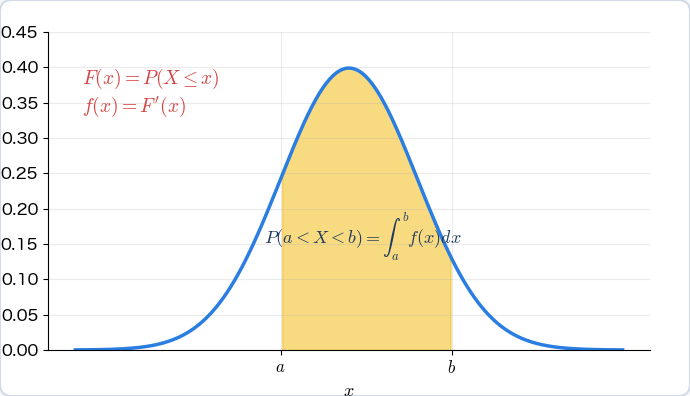
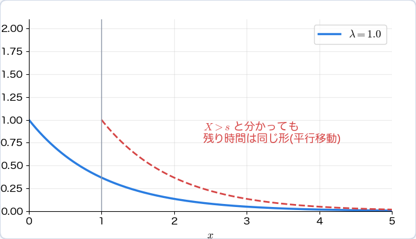
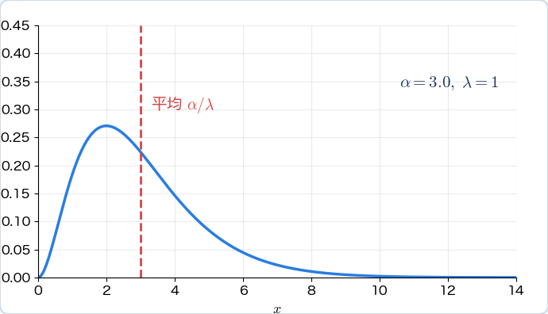
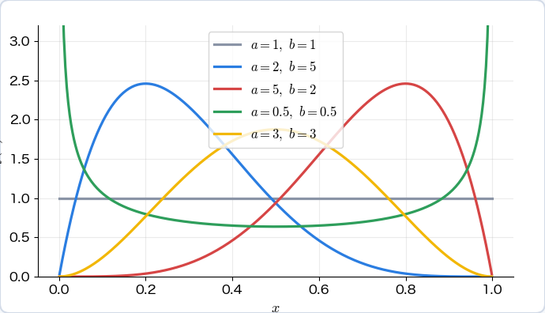
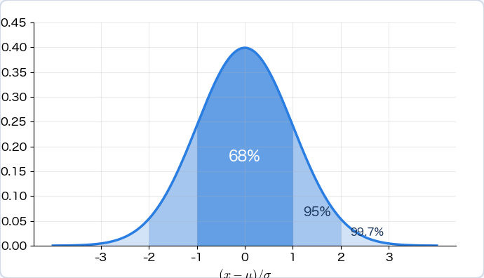
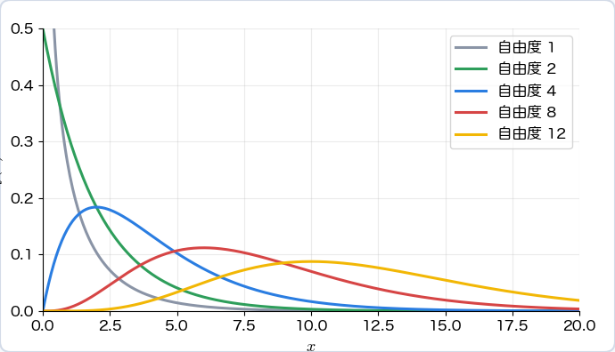
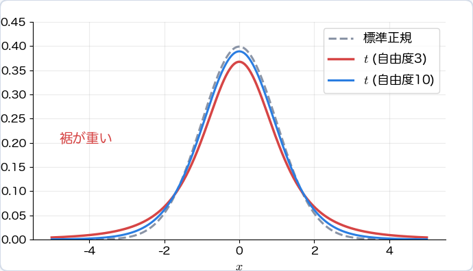
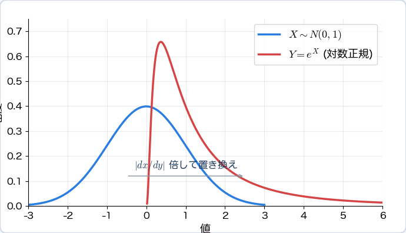
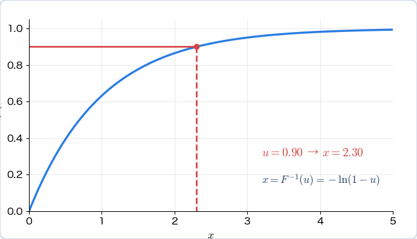
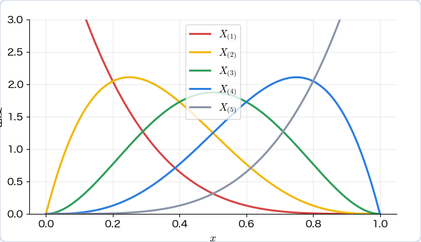

# 第2回　連続分布と変数変換

> **この回の学習目標**
>
> - 一様・指数・ガンマ・ベータ・正規分布の性質（期待値・分散・相互関係）を使い分けられる
> - $\chi^2$・$t$・$F$ 分布を「正規分布から作られる分布」として定義できる
> - 変数変換（密度の変換公式）、確率積分変換、順序統計量の分布を導出できる

## 0. おさらい：密度関数と累積分布関数

連続確率変数 $X$ は密度関数 $f(x)$ をもち、確率は面積（積分）で与えられます。

$$P(a<X<b)=\int_a^b f(x)\,dx,\qquad F(x)=P(X\le x)=\int_{-\infty}^x f(t)\,dt,\qquad f(x)=F'(x)$$

期待値 $E[X]=\int xf(x)dx$、分散 $V[X]=E[X^2]-(E[X])^2$ は離散の場合の和を積分に置き換えたものです。

## 1. 一様分布と指数分布

**一様分布 $U(a,b)$**：区間内で密度が一定。

$$f(x)=\frac{1}{b-a}\ (a<x<b),\qquad E[X]=\frac{a+b}{2},\quad V[X]=\frac{(b-a)^2}{12}$$

**指数分布**（待ち時間）：

$$f(x)=\lambda e^{-\lambda x}\ (x>0),\quad F(x)=1-e^{-\lambda x},\quad E[X]=\frac1\lambda,\ V[X]=\frac1{\lambda^2}$$

ポアソン過程（強度 $\lambda$）で、事象が起きる **間隔** が指数分布に従います。

**無記憶性**：$P(X>s+t\mid X>s)=\dfrac{e^{-\lambda(s+t)}}{e^{-\lambda s}}=e^{-\lambda t}=P(X>t)$。幾何分布の連続版です。

## 2. ガンマ分布

形状 $\alpha$、率 $\lambda$ のガンマ分布 $\mathrm{Gamma}(\alpha,\lambda)$：

$$f(x)=\frac{\lambda^\alpha}{\Gamma(\alpha)}x^{\alpha-1}e^{-\lambda x}\ (x>0),\qquad E[X]=\frac\alpha\lambda,\quad V[X]=\frac{\alpha}{\lambda^2}$$

- $\alpha=1$ のとき指数分布
- $\alpha$ が整数なら、**独立な指数分布 $\alpha$ 個の和**（$\alpha$ 個目の事象が起きるまでの待ち時間）
- 再生性：率 $\lambda$ が同じなら $\mathrm{Gamma}(\alpha_1,\lambda)+\mathrm{Gamma}(\alpha_2,\lambda)=\mathrm{Gamma}(\alpha_1+\alpha_2,\lambda)$

「ポアソン分布（個数）・指数分布（間隔）・ガンマ分布（$n$ 個目までの時間）」は一つの物語としてつながっています。

## 3. ベータ分布

区間 $(0,1)$ の値（確率・割合）の分布 $\mathrm{Beta}(a,b)$：

$$f(x)=\frac{x^{a-1}(1-x)^{b-1}}{B(a,b)},\qquad E[X]=\frac{a}{a+b},\quad V[X]=\frac{ab}{(a+b)^2(a+b+1)}$$

$a=b=1$ は一様分布、$a<b$ で左寄り、$a>b$ で右寄り、$a,b<1$ で U 字型。**二項分布の共役事前分布** として第11回（ベイズ統計）で活躍します。

## 4. 正規分布

$X\sim N(\mu,\sigma^2)$ の密度は $f(x)=\dfrac{1}{\sqrt{2\pi}\sigma}\exp\left\{-\dfrac{(x-\mu)^2}{2\sigma^2}\right\}$。

- **標準化**：$Z=\dfrac{X-\mu}{\sigma}\sim N(0,1)$
- 平均 $\pm1\sigma$ に約 68%、$\pm2\sigma$ に約 95%、$\pm3\sigma$ に約 99.7%
- **再生性（線形結合）**：独立な $X\sim N(\mu_X,\sigma_X^2)$, $Y\sim N(\mu_Y,\sigma_Y^2)$ に対し
  $$aX+bY\sim N\big(a\mu_X+b\mu_Y,\ a^2\sigma_X^2+b^2\sigma_Y^2\big)$$
  （平均は足し合わせ、分散は **係数の二乗** をかけて足す）
- 積率母関数：$M(t)=\exp(\mu t+\sigma^2t^2/2)$

## 5. $\chi^2$ 分布・$t$ 分布・$F$ 分布

正規分布から作られる、推定・検定の主役たちです。

**カイ二乗分布**　$Z_1,\dots,Z_n$ が独立な標準正規のとき

$$\chi^2_n=Z_1^2+\cdots+Z_n^2,\qquad E=n,\quad V=2n$$

$\chi^2_n=\mathrm{Gamma}(n/2,\,1/2)$。独立なら $\chi^2_m+\chi^2_n=\chi^2_{m+n}$（自由度が足される）。

**$t$ 分布**　$Z\sim N(0,1)$ と $V\sim\chi^2_n$ が独立のとき

$$t_n=\frac{Z}{\sqrt{V/n}}$$

標準正規分布に似ていますが **裾が重く**、自由度 $n$ が大きいと標準正規分布に近づきます。母分散が未知のときの平均の推定・検定に使います。

**$F$ 分布**　独立な $U\sim\chi^2_m$, $V\sim\chi^2_n$ に対し

$$F_{m,n}=\frac{U/m}{V/n}$$

分散の比、分散分析、回帰の検定に使います。$t_n^2=F_{1,n}$ という関係も覚えておきましょう。

## 6. 変数変換（1変数）

$X$ の密度 $f_X$ が分かっていて、$Y=g(X)$（$g$ は単調）のとき、

$$f_Y(y)=f_X\big(g^{-1}(y)\big)\left|\frac{dx}{dy}\right|$$

**絶対値を忘れない**（忘れると負の密度が出る）。確率が微小区間で保存される、$f_Y(y)|dy|=f_X(x)|dx|$ という考え方から導かれます。単調でないときは区間ごとに場合分けして足し合わせます。

例：$X\sim N(0,1)$, $Y=e^X$ なら $x=\ln y$, $|dx/dy|=1/y$ なので $f_Y(y)=\frac{1}{\sqrt{2\pi}\,y}e^{-(\ln y)^2/2}$（**対数正規分布**）。

## 7. 確率積分変換

$X$ が連続で累積分布関数が $F$ のとき、$F(X)\sim U(0,1)$ です（$P(F(X)\le u)=P(X\le F^{-1}(u))=u$）。

逆に $U\sim U(0,1)$ なら $F^{-1}(U)$ は分布関数 $F$ に従います。これが **逆関数法** による乱数生成です。指数分布なら $F^{-1}(u)=-\ln(1-u)/\lambda$。

## 8. 順序統計量

$X_1,\dots,X_n$ が独立同分布（分布関数 $F$、密度 $f$）のとき、小さい順に並べたものを $X_{(1)}\le\cdots\le X_{(n)}$ とします。

- 最大値：$P(X_{(n)}\le x)=F(x)^n$、密度 $nF^{n-1}f$
- 最小値：$P(X_{(1)}\le x)=1-(1-F(x))^n$、密度 $n(1-F)^{n-1}f$
- $k$ 番目：$$f_{(k)}(x)=\frac{n!}{(k-1)!\,(n-k)!}F(x)^{k-1}\{1-F(x)\}^{n-k}f(x)$$

（「$k-1$ 個が $x$ より下、1 個が $x$ ちょうど、$n-k$ 個が上」という多項型の数え上げ。）一様分布なら $X_{(k)}\sim\mathrm{Beta}(k,\,n-k+1)$。

## 演習問題

### 演習1　指数分布の最小値

**問題**　電球の寿命は平均 10 時間の指数分布に従う。独立な 3 個を同時に点灯したとき、最初に切れるまでの時間 $T$ の期待値と $P(T>5)$ を求めよ。

**解答**　1 個が $t$ 時間より長持ちする確率は $e^{-0.1t}$。3 個とも長持ちする確率が $P(T>t)=e^{-0.3t}$ なので、**$T$ は率 0.3 の指数分布**。$E[T]=1/0.3=10/3\approx\mathbf{3.33}$ 時間、$P(T>5)=e^{-1.5}\approx\mathbf{0.223}$。

（一般に、率 $\lambda$ の指数分布 $n$ 個の最小値は率 $n\lambda$ の指数分布。）

### 演習2　変数変換

**問題**　$X\sim U(0,1)$, $Y=X^2$ の密度関数と $E[Y]$ を求めよ。

**解答**　$x=\sqrt y$, $|dx/dy|=\dfrac{1}{2\sqrt y}$、$f_X=1$ なので $f_Y(y)=\dfrac{1}{2\sqrt y}\ (0<y<1)$。

$$E[Y]=\int_0^1 y\cdot\frac{1}{2\sqrt y}dy=\frac12\int_0^1y^{1/2}dy=\frac13$$

直接 $E[X^2]=\int_0^1x^2dx=1/3$ と計算しても一致する。

### 演習3　一様分布の最大値

**問題**　独立な 5 個の $U(0,1)$ 乱数の最大値を $M$ とする。$P(M\le0.9)$ と $E[M]$ を求めよ。

**解答**　$P(M\le0.9)=0.9^5\approx\mathbf{0.590}$。密度は $f_M(x)=5x^4$ なので $E[M]=\int_0^1 5x^5dx=\dfrac56$。$\mathrm{Beta}(5,1)$ の平均 $5/6$ と一致する。

### 演習4（発展）　$\chi^2$ 分布の和

**問題**　$X_1,\dots,X_4$ が独立に $N(0,1)$ に従うとき、$\sum X_i^2$ の期待値と分散を求めよ。また $X_1^2+X_2^2$ はどんな分布か。

**解答**　$\chi^2_4$ なので期待値 $4$、分散 $8$。$X_1^2+X_2^2\sim\chi^2_2$ は指数分布（率 $1/2$、平均 2）。

## まとめ・チェックリスト

- [ ] 指数分布の無記憶性、ガンマ分布との関係（個数・間隔・$n$ 個目）を説明できる
- [ ] 正規分布の線形結合の平均・分散を計算できる
- [ ] $\chi^2$・$t$・$F$ の定義と $t_n^2=F_{1,n}$ を言える
- [ ] 変数変換の公式（絶対値つき）と、逆関数法を使える
- [ ] 最大値・最小値・$k$ 番目の順序統計量の分布を導出できる

次回：**多変量分布と多変量正規分布**
