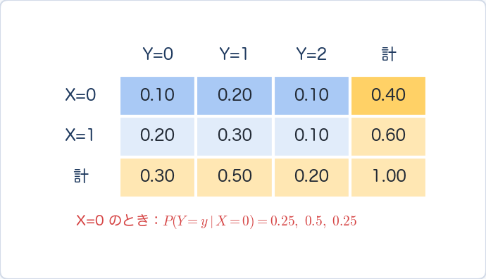
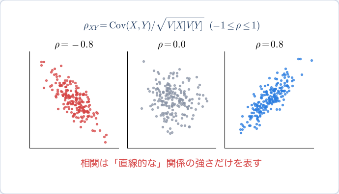
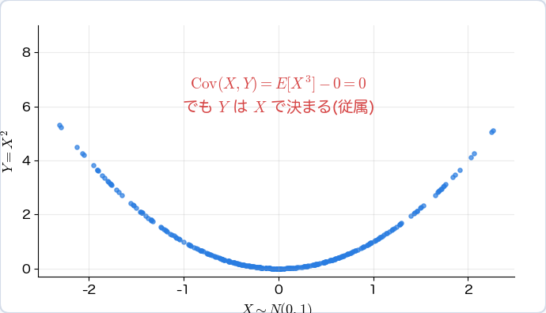
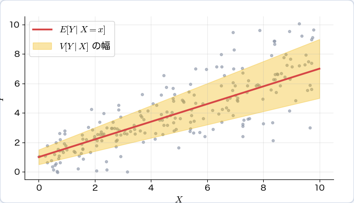
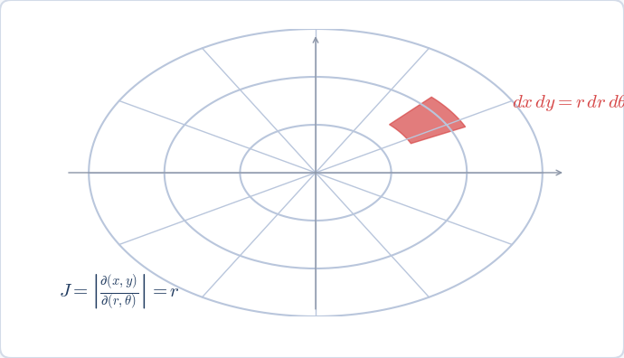
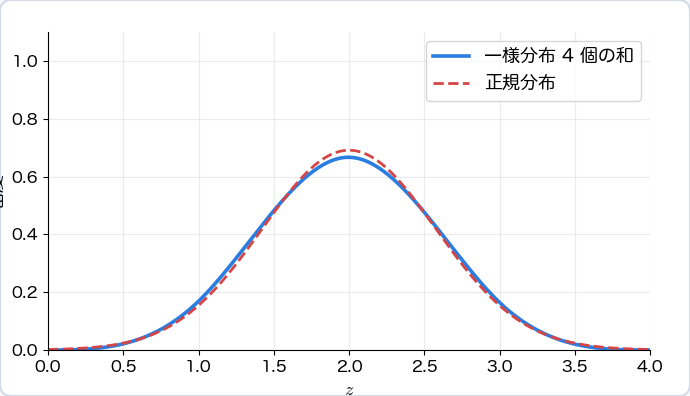
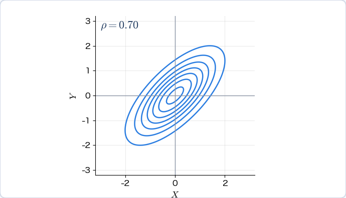
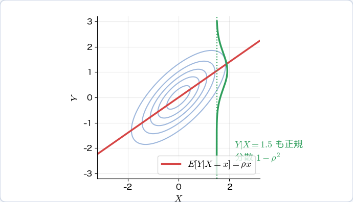
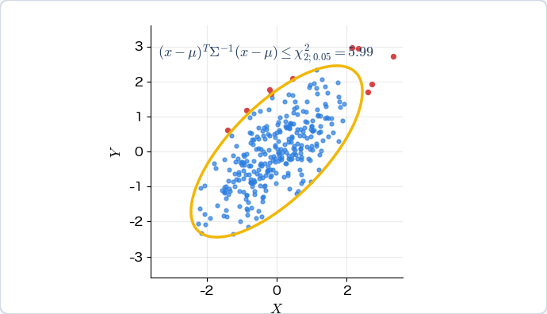

# 第3回　多変量分布と多変量正規分布

> **この回の学習目標**
>
> - 同時分布・周辺分布・条件付き分布の関係を計算できる
> - 共分散・相関、独立と無相関の違い、全分散の法則を使える
> - 2 変数の変換（ヤコビアン）と和の分布（畳み込み）を扱える
> - 多変量正規分布の性質（周辺・線形変換・条件付き）と、マハラノビス距離を理解する

## 1. 同時分布・周辺分布・条件付き分布

2 つの確率変数 $(X,Y)$ の **同時確率（密度）** $f(x,y)$ から、

$$\text{周辺：}\ f_X(x)=\int f(x,y)\,dy\quad(\text{離散なら和}),\qquad \text{条件付き：}\ f(y\mid x)=\frac{f(x,y)}{f_X(x)}$$

独立 $\Leftrightarrow f(x,y)=f_X(x)f_Y(y)$（すべての $x,y$ で）。

離散の例（行：$X$、列：$Y$）

| | $Y=0$ | $Y=1$ | $Y=2$ | 計 |
|---|---|---|---|---|
| $X=0$ | 0.10 | 0.20 | 0.10 | **0.40** |
| $X=1$ | 0.20 | 0.30 | 0.10 | **0.60** |
| 計 | **0.30** | **0.50** | **0.20** | 1.00 |

行・列の合計が周辺分布。$X=0$ のときの $Y$ の条件付き分布は、行を 0.4 で割って $(0.25,\,0.5,\,0.25)$。

## 2. 共分散と相関係数

$$\mathrm{Cov}(X,Y)=E[(X-E[X])(Y-E[Y])]=E[XY]-E[X]E[Y],\qquad \rho_{XY}=\frac{\mathrm{Cov}(X,Y)}{\sqrt{V[X]V[Y]}}$$

- $-1\le\rho\le1$。$|\rho|=1$ は完全な直線関係
- 相関は **直線的な関係** の強さしか測れない
- $V[X+Y]=V[X]+V[Y]+2\mathrm{Cov}(X,Y)$、$\mathrm{Cov}(aX,bY)=ab\,\mathrm{Cov}(X,Y)$

## 3. 独立と無相関

独立 $\Rightarrow$ 無相関（共分散 0）。**逆は一般に成り立ちません**。

反例：$X\sim N(0,1)$, $Y=X^2$。$Y$ は $X$ で決まる（従属）のに、$\mathrm{Cov}(X,Y)=E[X^3]-E[X]E[X^2]=0$。ただし **二変量（多変量）正規分布のときに限り、無相関 $\Leftrightarrow$ 独立** です。

## 4. 条件付き期待値と全分散の法則

$E[Y\mid X]$ は $X$ の関数（確率変数）です。

$$E[Y]=E\big[E[Y\mid X]\big]\quad(\text{繰り返し期待値の法則})$$

$$V[Y]=E\big[V[Y\mid X]\big]+V\big[E[Y\mid X]\big]\quad(\text{全分散の法則})$$

「**群内のばらつきの平均 ＋ 群間のばらつき**」という分解で、分散分析（第10回）と同じ発想です。

> **例（複合分布）**　個数 $N$ と各回の値 $X_i$（独立同分布で $N$ とも独立）の合計 $S=\sum_{i=1}^NX_i$ では
> $E[S]=E[N]E[X]$、$V[S]=E[N]V[X]+V[N]E[X]^2$。

## 5. 2 変数の変換とヤコビアン

$(x,y)\to(u,v)$ の 1 対 1 変換で、

$$f_{U,V}(u,v)=f_{X,Y}(x,y)\,|J|,\qquad J=\det\begin{pmatrix}\partial x/\partial u&\partial x/\partial v\\\partial y/\partial u&\partial y/\partial v\end{pmatrix}$$

（1 変数の $|dx/dy|$ の拡張）。例：極座標 $x=r\cos\theta,\ y=r\sin\theta$ では $|J|=r$。独立な標準正規 $X,Y$ に使うと、$R^2=X^2+Y^2\sim\chi^2_2$、角度 $\theta\sim U(0,2\pi)$ で $R$ と独立になる（ボックス＝ミュラー法の根拠）。

## 6. 和の分布（畳み込み）

独立な $X,Y$ の和 $Z=X+Y$ の密度は

$$f_Z(z)=\int f_X(x)f_Y(z-x)\,dx$$

一様分布 2 個の和は三角形、3 個、4 個…と足すほど釣り鐘型に近づきます（中心極限定理）。畳み込みを直接計算せず、**積率母関数の積** で分布を同定する方法も使えます。

## 7. 多変量正規分布

$p$ 次元ベクトル $X\sim N_p(\mu,\Sigma)$（平均ベクトル $\mu$、分散共分散行列 $\Sigma$）の密度は

$$f(x)=\frac{1}{(2\pi)^{p/2}|\Sigma|^{1/2}}\exp\left\{-\frac12(x-\mu)^T\Sigma^{-1}(x-\mu)\right\}$$

等高線は楕円で、相関が強いほど細長くなります。重要な性質は次の 4 つです。

1. **周辺分布** も正規分布（$X_j\sim N(\mu_j,\Sigma_{jj})$）
2. **線形変換** で閉じる：$AX+b\sim N(A\mu+b,\ A\Sigma A^T)$
3. **無相関 $\Leftrightarrow$ 独立**
4. **条件付き分布** も正規分布（次項）

## 8. 多変量正規分布の条件付き分布

二変量正規分布で $X=x$ を与えたとき、

$$Y\mid X=x\ \sim\ N\left(\mu_Y+\rho\frac{\sigma_Y}{\sigma_X}(x-\mu_X),\ \ \sigma_Y^2(1-\rho^2)\right)$$

- 条件付き期待値は $x$ の **一次関数**（これが回帰直線そのもの。傾き $\rho\sigma_Y/\sigma_X=\mathrm{Cov}/\sigma_X^2$）
- 条件付き分散 $\sigma_Y^2(1-\rho^2)$ は $x$ に **よらず一定**（$|\rho|$ が大きいほど小さくなる）

## 9. マハラノビス距離

$$D^2=(x-\mu)^T\Sigma^{-1}(x-\mu)$$

ばらつきの大きい方向は距離を小さく見積もる、共分散を考慮した距離です。$X\sim N_p(\mu,\Sigma)$ のとき $D^2\sim\chi^2_p$ なので、外れ値の検出や確率楕円（二変量の 95% 楕円は $D^2\le\chi^2_{2;0.05}=5.99$）に使えます。

## 演習問題

### 演習1　共分散と相関

**問題**　$X,Y$ は 0 か 1 をとり、同時確率は $P(0,0)=0.3,\ P(0,1)=0.2,\ P(1,0)=0.1,\ P(1,1)=0.4$。共分散と相関係数を求めよ。

**解答**　$E[X]=P(X=1)=0.5$, $E[Y]=P(Y=1)=0.6$, $E[XY]=P(1,1)=0.4$ なので $\mathrm{Cov}=0.4-0.5\times0.6=\mathbf{0.1}$。
ベルヌーイなので $V[X]=0.5\times0.5=0.25$, $V[Y]=0.6\times0.4=0.24$、$\rho=\dfrac{0.1}{\sqrt{0.25\times0.24}}=\dfrac{0.1}{\sqrt{0.06}}\approx\mathbf{0.41}$。

### 演習2　全分散の法則

**問題**　ある店の 1 日の客数 $N$ は平均 3 のポアソン分布。各客の購入額は独立に平均 2（千円）、分散 1 で、$N$ とも独立。売上合計 $S$ の期待値と分散を求めよ。

**解答**　$N$ を与えると $E[S\mid N]=2N$, $V[S\mid N]=N$。
$E[S]=E[2N]=\mathbf{6}$。
$V[S]=E[V[S\mid N]]+V[E[S\mid N]]=E[N]+V[2N]=3+4\times3=\mathbf{15}$（ポアソンの分散は平均に等しい）。

### 演習3　二変量正規分布

**問題**　$(X,Y)$ は二変量正規で平均はともに 0、$V[X]=4$, $V[Y]=9$, $\mathrm{Cov}(X,Y)=3$。$\rho$、$E[Y\mid X=2]$、$V[Y\mid X=2]$ を求めよ。

**解答**　$\rho=\dfrac{3}{2\times3}=\mathbf{0.5}$。
$E[Y\mid X=x]=\dfrac{\mathrm{Cov}}{V[X]}x=\dfrac34x$ なので $x=2$ で $\mathbf{1.5}$。
$V[Y\mid X]=9(1-0.25)=\mathbf{6.75}$（$=9-3^2/4$ でも同じ）。

### 演習4（発展）　線形変換

**問題**　$X_1,X_2$ が独立に $N(0,1)$ に従うとき、$U=X_1+X_2$, $V=X_1-X_2$ は独立か。

**解答**　$(U,V)$ は $(X_1,X_2)$ の線形変換なので二変量正規。$\mathrm{Cov}(U,V)=V[X_1]-V[X_2]=0$ で無相関、**正規なので独立**。

## まとめ・チェックリスト

- [ ] 同時分布から周辺・条件付き分布を求められる
- [ ] 共分散の計算、独立と無相関の違い（反例と正規分布のときの例外）を説明できる
- [ ] 全分散の法則 $V[Y]=E[V[Y\mid X]]+V[E[Y\mid X]]$ を使える
- [ ] ヤコビアン変換と畳み込みの考え方を説明できる
- [ ] 多変量正規分布の 4 性質と、条件付き分布の平均・分散の式を書ける

次回：**大数の法則・中心極限定理・標本分布**
