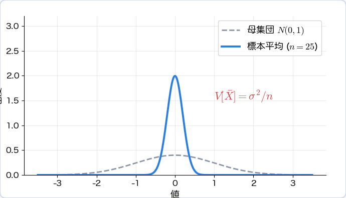
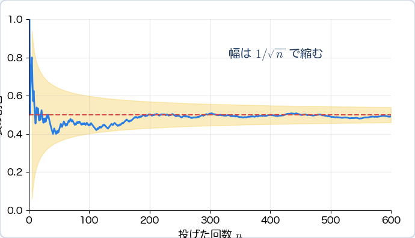
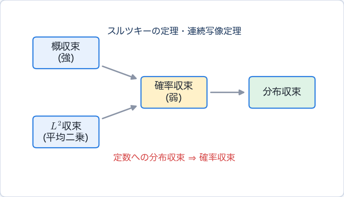
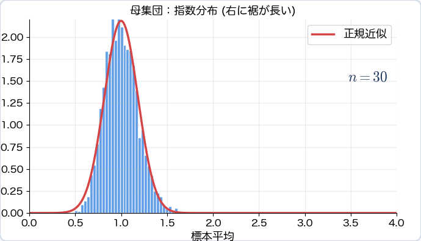
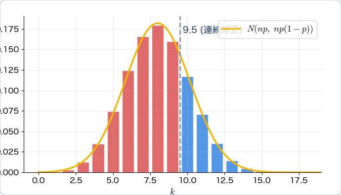
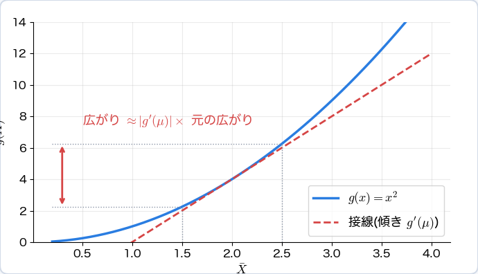
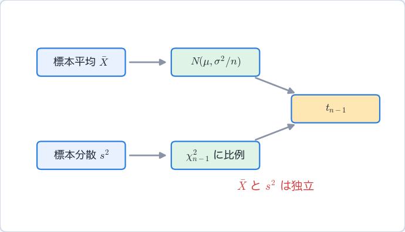
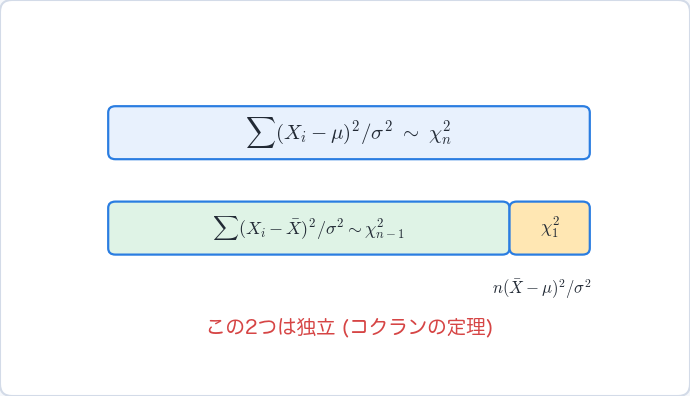

# 第4回　大数の法則・中心極限定理・標本分布

> **この回の学習目標**
>
> - 標本平均・不偏分散の性質と、大数の法則・収束の種類を説明できる
> - 中心極限定理・正規近似（連続修正）・デルタ法を使える
> - 正規母集団の標本分布（$\chi^2$・$t$）と、自由度が $n-1$ になる理由を説明できる

## 1. 標本平均の分布

母平均 $\mu$、母分散 $\sigma^2$ の母集団から独立に $n$ 個を取る（$X_1,\dots,X_n$）。標本平均 $\bar X=\frac1n\sum X_i$ について

$$E[\bar X]=\mu,\qquad V[\bar X]=\frac{\sigma^2}{n}$$

標準偏差（**標準誤差**）は $\sigma/\sqrt n$ なので、精度を 2 倍にするには標本サイズを **4 倍** にします。

**不偏分散** $s^2=\dfrac1{n-1}\sum(X_i-\bar X)^2$ は $E[s^2]=\sigma^2$（$n$ で割ると偏りが出る）。

## 2. 大数の法則

$$\bar X_n\to\mu\quad(n\to\infty)$$

- **弱法則**：確率収束 $P(|\bar X_n-\mu|>\varepsilon)\to0$。チェビシェフの不等式 $P(|X-\mu|\ge k\sigma)\le1/k^2$ から簡単に示せる：$P(|\bar X_n-\mu|>\varepsilon)\le\dfrac{\sigma^2}{n\varepsilon^2}\to0$
- **強法則**：確率 1 で収束（概収束）

## 3. 収束の種類

| 収束 | 意味 |
|---|---|
| 概収束 | 確率 1 で $X_n(\omega)\to X(\omega)$ |
| $L^2$（平均二乗）収束 | $E[(X_n-X)^2]\to0$ |
| 確率収束 | $P(|X_n-X|>\varepsilon)\to0$ |
| 分布収束 | 分布関数が（連続点で）収束 |

強さの順：**概収束 ⇒ 確率収束 ⇒ 分布収束**、$L^2$ 収束 ⇒ 確率収束。逆は一般に不成立ですが、**定数への分布収束は確率収束と同値** です。

**スルツキーの定理**：$X_n\xrightarrow{d}X$, $Y_n\xrightarrow{p}c$（定数）なら $X_n+Y_n\xrightarrow{d}X+c$, $X_nY_n\xrightarrow{d}cX$, $X_n/Y_n\xrightarrow{d}X/c$（$c\ne0$）。母分散を標本分散で置き換える議論で頻繁に使います。

## 4. 中心極限定理

$X_1,\dots,X_n$ が独立同分布で、平均 $\mu$、分散 $\sigma^2$（有限）のとき

$$\frac{\sqrt n(\bar X_n-\mu)}{\sigma}\xrightarrow{d}N(0,1)$$

母集団の分布が何でも成り立ちます。ただし元の分布が偏っているほど大きな $n$ が必要です（目安 $n\ge30$）。右に裾の長い指数分布でも、標本平均の分布は $n$ とともに釣り鐘型に近づきます。

（証明の骨子：標準化した和の積率母関数を展開すると $1+\frac{t^2}{2n}+o(1/n)$ となり、$n$ 乗して $e^{t^2/2}$ に収束する。）

## 5. 二項分布の正規近似と連続修正

$X\sim B(n,p)$ は $n$ が大きいとき $N(np,\,np(1-p))$ で近似できます（目安：$np\ge5$ かつ $n(1-p)\ge5$）。離散を連続で近似するので、**連続修正** を行います。

$$P(X\le k)\approx\Phi\left(\frac{k+0.5-np}{\sqrt{np(1-p)}}\right),\qquad P(X\ge k)\approx1-\Phi\left(\frac{k-0.5-np}{\sqrt{np(1-p)}}\right)$$

## 6. デルタ法

$\sqrt n(\bar X-\mu)\xrightarrow{d}N(0,\sigma^2)$ で $g$ が微分可能（$g'(\mu)\ne0$）なら

$$\sqrt n\{g(\bar X)-g(\mu)\}\xrightarrow{d}N\big(0,\ g'(\mu)^2\sigma^2\big)$$

$g$ を $\mu$ のまわりで一次近似 $g(\bar X)\approx g(\mu)+g'(\mu)(\bar X-\mu)$ すると、広がりが接線の傾き倍になる、という考え方です。比や対数変換の分散の近似、分散安定化変換に使います。

## 7. 正規母集団の標本分布

母集団が $N(\mu,\sigma^2)$ のとき、**有限の $n$ でも正確な分布** が分かります。

$$\bar X\sim N\left(\mu,\frac{\sigma^2}{n}\right),\qquad \frac{(n-1)s^2}{\sigma^2}\sim\chi^2_{n-1},\qquad \bar X\ \text{と}\ s^2\ \text{は独立}$$

$\sigma$ を $s$ で置き換えると

$$t=\frac{\bar X-\mu}{s/\sqrt n}=\frac{(\bar X-\mu)/(\sigma/\sqrt n)}{\sqrt{\{(n-1)s^2/\sigma^2\}/(n-1)}}\sim t_{n-1}$$

**$\bar X$ と $s^2$ が独立** であることが $t$ 分布の定義に必要で、これは正規分布に特有の性質です。

## 8. 偏差平方和の分解とコクランの定理

$$\sum(X_i-\mu)^2=\sum(X_i-\bar X)^2+n(\bar X-\mu)^2$$

両辺を $\sigma^2$ で割ると、左辺は $\chi^2_n$、右辺第 2 項は $\chi^2_1$ なので、第 1 項は $\chi^2_{n-1}$（かつ独立）になります。標本平均を使うと **自由度が 1 減る** のはこのためです。この「二乗和の分解と独立性」を保証するのがコクランの定理で、回帰や分散分析でも同じ構造が現れます。

## 演習問題

### 演習1　正規近似

**問題**　コインを 100 回投げて表が 60 回以上出る確率を、連続修正つきの正規近似で求めよ。

**解答**　$X\sim B(100,0.5)$ で $\mu=50$, $\sigma=\sqrt{25}=5$。$P(X\ge60)=P(X\ge59.5)$ なので $z=\dfrac{59.5-50}{5}=1.9$、$P(Z\ge1.9)\approx\mathbf{0.029}$。（修正なしだと $z=2.0$ で約 0.023 となりずれる。）

### 演習2　標本平均

**問題**　母集団が $N(100,15^2)$。25 個の標本平均が 105 を超える確率は。

**解答**　$\bar X\sim N(100,\,(15/5)^2=3^2)$。$z=\dfrac{105-100}{3}\approx1.67$、$P(Z>1.67)\approx\mathbf{0.048}$。個々の値でなく平均なので、ばらつきが小さく確率は低くなる。

### 演習3　標本分散の分布

**問題**　正規母集団から $n=10$ の標本を取り、不偏分散を $s^2$ とする。$P(s^2>1.88\sigma^2)$ を求めよ（$\chi^2_9$ の上側 5% 点は 16.92）。

**解答**　$\dfrac{9s^2}{\sigma^2}\sim\chi^2_9$。$s^2>1.88\sigma^2\Leftrightarrow\dfrac{9s^2}{\sigma^2}>9\times1.88=16.92$ なので、確率は **5%**。

### 演習4（発展）　デルタ法

**問題**　$X_1,\dots,X_n\sim$ ポアソン $Po(\lambda)$ のとき、$\sqrt{\bar X}$ の漸近分散を求めよ（分散安定化変換）。

**解答**　$g(x)=\sqrt x$, $g'(\lambda)=\dfrac1{2\sqrt\lambda}$。$\sqrt n(\sqrt{\bar X}-\sqrt\lambda)\to N\left(0,\dfrac{1}{4\lambda}\cdot\lambda\right)=N\left(0,\dfrac14\right)$。分散が $\lambda$ に依存しなくなる。

## まとめ・チェックリスト

- [ ] $V[\bar X]=\sigma^2/n$ と不偏分散を説明できる
- [ ] 大数の法則（弱・強）と収束の種類の強さの順を言える
- [ ] 中心極限定理・連続修正つき正規近似・デルタ法を計算に使える
- [ ] $\bar X$ と $s^2$ の独立性、$(n-1)s^2/\sigma^2\sim\chi^2_{n-1}$、$t_{n-1}$ の導出を説明できる

次回：**点推定と最尤法**
