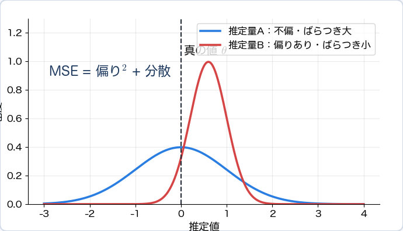
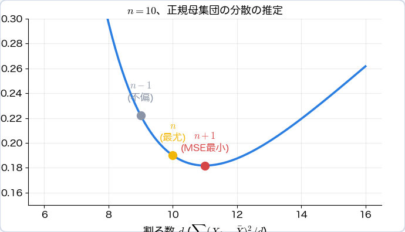
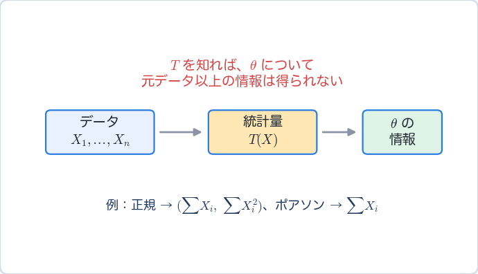
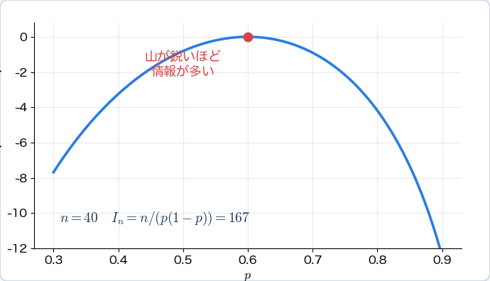
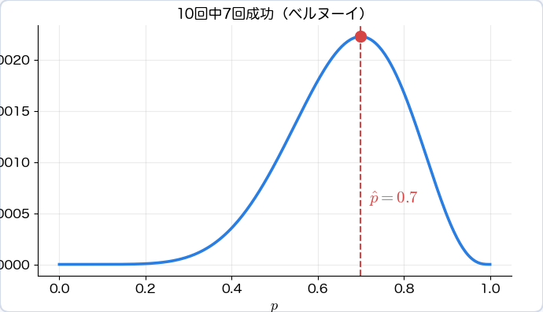
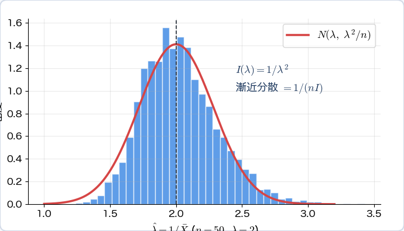
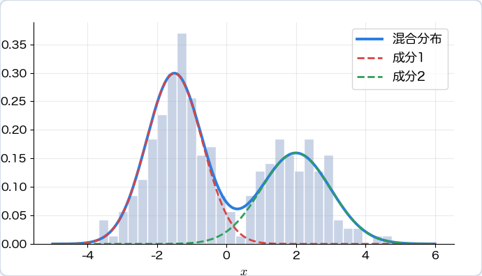

# 第5回　点推定と最尤法

> **この回の学習目標**
>
> - 推定量の良さ（不偏性・一致性・有効性・MSE）を評価できる
> - 十分統計量、ラオ・ブラックウェル、クラメール・ラオの不等式を説明できる
> - 最尤法・モーメント法で推定量を導出し、最尤推定量の性質を使える

## 1. 推定量の性質

母数 $\theta$ の推定量 $\hat\theta$ はデータの関数なので、それ自身が **確率変数** です。

| 性質 | 定義 |
|---|---|
| 不偏性 | $E[\hat\theta]=\theta$ |
| 一致性 | $\hat\theta_n\xrightarrow{p}\theta$（$n\to\infty$） |
| 有効性 | 不偏推定量の中で分散が小さい |
| 平均二乗誤差 | $\mathrm{MSE}=E[(\hat\theta-\theta)^2]=\underbrace{(E[\hat\theta]-\theta)^2}_{\text{偏り}^2}+V[\hat\theta]$ |

不偏でも分散が大きい推定量より、**少し偏っていても分散が小さい** 推定量の方が MSE が小さいことがあります。

## 2. 例：分散の推定量と MSE

正規母集団で $S=\sum(X_i-\bar X)^2\sim\sigma^2\chi^2_{n-1}$。$d$ で割った推定量 $S/d$ の MSE を $\sigma^4$ で割ると

$$\frac{\mathrm{MSE}}{\sigma^4}=\left(\frac{n-1}{d}-1\right)^2+\frac{2(n-1)}{d^2}$$

- $d=n-1$：不偏分散
- $d=n$：最尤推定量
- **$d=n+1$ で MSE 最小**

不偏性は絶対的な基準ではなく、バイアスと分散のトレードオフがあります。

## 3. 十分統計量

統計量 $T(X)$ が **十分** とは、$T$ を知れば $\theta$ について元のデータ以上の情報が得られないことです。

**フィッシャー・ネイマンの分解定理**：同時密度（確率）が

$$f(x;\theta)=g\big(T(x),\theta\big)\,h(x)$$

（$h$ は $\theta$ を含まない）と書けるとき $T$ は十分統計量。

- 正規分布（平均・分散とも未知）：$(\sum X_i,\ \sum X_i^2)$
- ポアソン：$\sum X_i$
- 指数型分布族では十分統計量がすぐ見つかる

## 4. ラオ・ブラックウェルの定理と UMVUE

不偏推定量 $\hat\theta$ を十分統計量 $T$ で条件付けた $E[\hat\theta\mid T]$ は、不偏のまま **分散が同じか小さくなる**（ラオ・ブラックウェル）。

さらに $T$ が **完備** な十分統計量なら、$T$ の関数である不偏推定量は一意で、**一様最小分散不偏推定量（UMVUE）** になります（レーマン・シェッフェ）。

## 5. フィッシャー情報量とクラメール・ラオの不等式

**フィッシャー情報量**（1 個の観測あたり）

$$I(\theta)=E\left[\left(\frac{\partial\log f(X;\theta)}{\partial\theta}\right)^2\right]=-E\left[\frac{\partial^2\log f(X;\theta)}{\partial\theta^2}\right]$$

対数尤度の山の鋭さ（曲率）です。独立な $n$ 個なら $nI(\theta)$。

**クラメール・ラオの不等式**：$\theta$ の任意の不偏推定量について

$$V[\hat\theta]\ge\frac{1}{nI(\theta)}$$

下限に達する推定量を **有効推定量** と呼びます。

例：ベルヌーイ $I(p)=\dfrac1{p(1-p)}$、ポアソン $I(\lambda)=\dfrac1\lambda$、正規（$\sigma$ 既知）の $\mu$ について $I=\dfrac1{\sigma^2}$。

## 6. 最尤法

**尤度** $L(\theta)=\prod_{i=1}^nf(x_i;\theta)$ を最大にする $\theta$ が **最尤推定量（MLE）** $\hat\theta$。対数尤度 $\ell=\log L$ を微分して 0 とおく（尤度方程式）：

$$\frac{\partial\ell}{\partial\theta}=0$$

| 分布 | 最尤推定量 |
|---|---|
| ベルヌーイ・二項（$n$ 回中 $k$ 回成功） | $\hat p=k/n$ |
| 正規 | $\hat\mu=\bar x,\ \ \hat\sigma^2=\dfrac1n\sum(x_i-\bar x)^2$（**$n$ で割る**） |
| ポアソン | $\hat\lambda=\bar x$ |
| 指数（率） | $\hat\lambda=1/\bar x$ |

**微分で解けない例**：$U(0,\theta)$ では $L(\theta)=\theta^{-n}$（$\theta\ge x_{(n)}$）が減少関数なので、$\hat\theta=X_{(n)}$（最大値）になります。

## 7. 最尤推定量の性質

正則条件のもとで、

1. **一致性**
2. **漸近正規性**：$\sqrt n(\hat\theta-\theta)\xrightarrow{d}N\big(0,\ I(\theta)^{-1}\big)$
3. **漸近有効性**（分散がクラメール・ラオの下限に一致）
4. **不変性**：$\theta$ の MLE が $\hat\theta$ なら、$g(\theta)$ の MLE は $g(\hat\theta)$

有限標本では偏りが残ることもあります（例：正規の $\hat\sigma^2$）。

## 8. モーメント法

標本モーメントを理論モーメントに等しいとおいて母数を解く方法です。ガンマ分布なら平均 $\alpha/\lambda$、分散 $\alpha/\lambda^2$ から

$$\hat\alpha=\frac{\bar x^2}{s^2},\qquad\hat\lambda=\frac{\bar x}{s^2}$$

尤度方程式が解きにくいときに便利ですが、一般に最尤法より効率が劣ります。

## 9. EM アルゴリズム

混合分布のように **どの成分から来たか（潜在変数）** が分からないとき、尤度の直接最大化は困難です。

- **E ステップ**：現在の母数で、各データが各成分に属する確率（負担率）を計算
- **M ステップ**：その確率を重みにして、重み付き最尤で母数を更新

これを繰り返すと尤度が **単調に増加** して局所最大に収束します（初期値依存に注意）。

## 演習問題

### 演習1　一様分布の最尤推定

**問題**　$U(0,\theta)$ から $n$ 個の標本。$\theta$ の最尤推定量とその期待値を求めよ。

**解答**　$L(\theta)=\theta^{-n}$（$\theta\ge x_{(n)}$）、それ未満では 0。減少関数なので $\hat\theta=X_{(n)}$。最大値の密度は $nx^{n-1}/\theta^n$ なので $E[\hat\theta]=\dfrac{n}{n+1}\theta$、**不偏でない**。$\dfrac{n+1}{n}X_{(n)}$ にすれば不偏。

### 演習2　ポアソン分布とクラメール・ラオ

**問題**　ポアソン分布の $\lambda$ について、最尤推定量・フィッシャー情報量・クラメール・ラオの下限を求めよ。

**解答**　$\ell=-n\lambda+\sum x_i\log\lambda+\text{定数}$、$\ell'=-n+\dfrac{\sum x_i}{\lambda}=0$ より $\hat\lambda=\bar X$。$I(\lambda)=1/\lambda$、下限 $\dfrac{\lambda}{n}$。$V[\bar X]=\dfrac\lambda n$ で一致するので **$\bar X$ は有効推定量**。

### 演習3　モーメント法と効率

**問題**　$U(0,\theta)$ について、モーメント推定量と修正最尤推定量の分散を比較せよ。

**解答**　$E[X]=\theta/2$ より $\tilde\theta=2\bar X$（不偏）、$V[\tilde\theta]=4\cdot\dfrac{\theta^2/12}{n}=\dfrac{\theta^2}{3n}$。修正最尤推定量 $\hat\theta^*=\dfrac{n+1}{n}X_{(n)}$ は $V[X_{(n)}]=\dfrac{n\theta^2}{(n+1)^2(n+2)}$ より $V[\hat\theta^*]=\dfrac{\theta^2}{n(n+2)}$。**$n^2$ に反比例して小さい**ので最尤の方が効率的。

### 演習4（発展）　指数分布の MLE の偏り

**問題**　指数分布（率 $\lambda$）の最尤推定量 $\hat\lambda=1/\bar X$ は不偏か。

**解答**　$\sum X_i\sim\mathrm{Gamma}(n,\lambda)$ で $E[1/\sum X_i]=\dfrac{\lambda}{n-1}$。よって $E[\hat\lambda]=n\cdot\dfrac{\lambda}{n-1}=\dfrac{n}{n-1}\lambda$。**不偏でない**（$\frac{n-1}{n}\hat\lambda$ なら不偏）。ただし一致推定量。

## まとめ・チェックリスト

- [ ] 不偏性・一致性・有効性・MSE（偏り² + 分散）を区別できる
- [ ] 分解定理で十分統計量を見つけられる
- [ ] フィッシャー情報量を計算し、クラメール・ラオの下限と比べられる
- [ ] 尤度方程式から MLE を導出できる（微分できない場合も含む）
- [ ] 最尤推定量の 4 つの性質、モーメント法、EM アルゴリズムの流れを説明できる

次回：**区間推定と仮説検定の理論**
