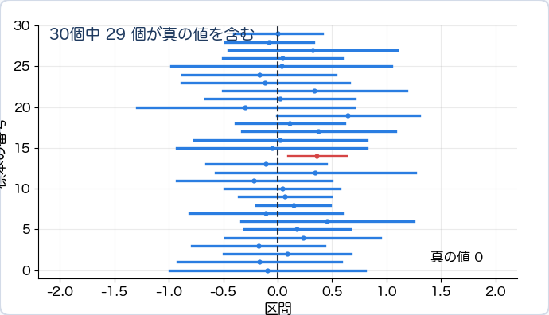
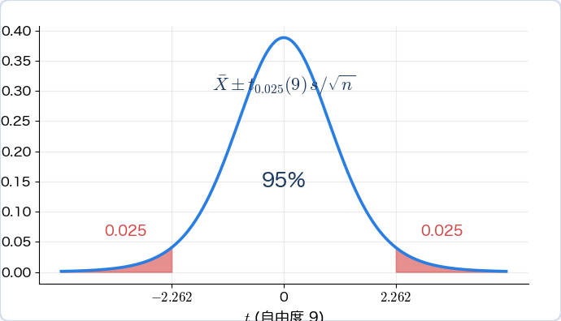
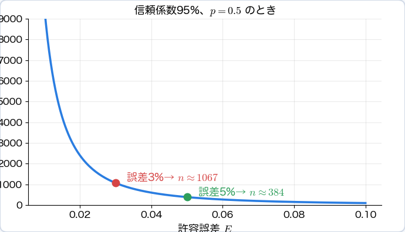
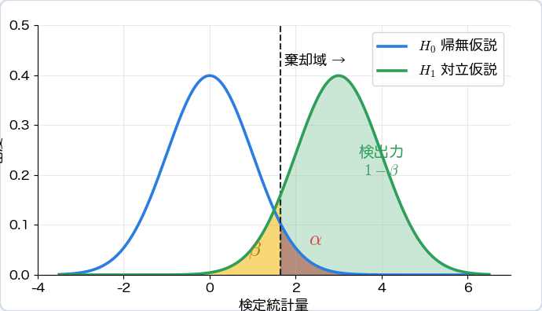
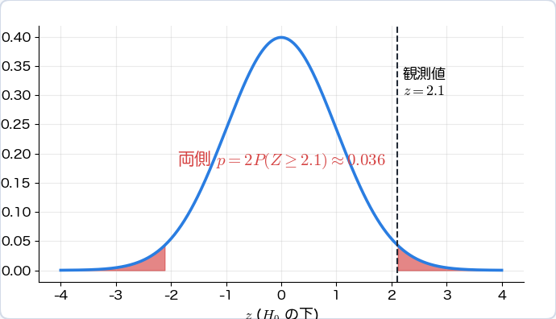
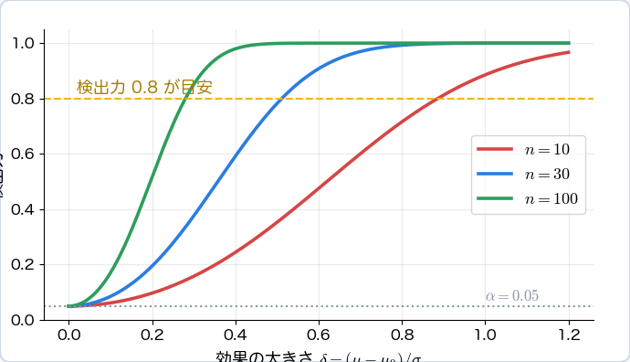
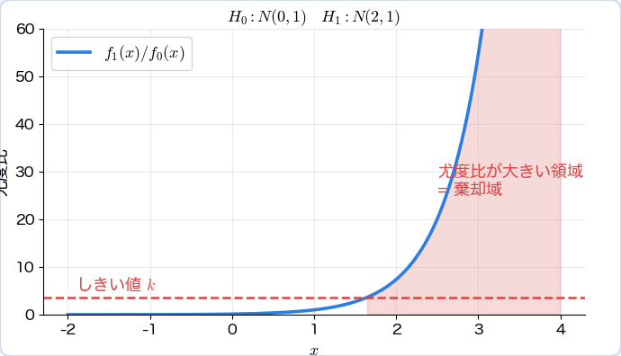
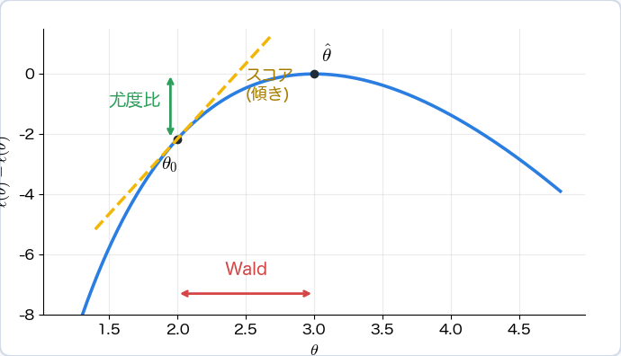

# 第6回　区間推定と仮説検定の理論

> **この回の学習目標**
>
> - 信頼区間の意味を正しく説明し、平均・分散・比率の区間を構成できる
> - 第一種・第二種の誤り、p 値、検出力、標本サイズ設計を説明できる
> - ネイマン・ピアソンの補題、尤度比・ワルド・スコア検定の考え方を理解する

## 1. 信頼区間の意味

95% 信頼区間とは、**同じ手順で標本を取り直して区間を作ることを繰り返したとき、その 95% が真の値を含む** という意味です。

> 「この区間が 95% の確率で真の値を含む」と言うのは厳密には誤りです。真の値 $\theta$ は固定された定数で、確率的に動くのは **区間の方** だからです（ベイズの信用区間との違い、第11回）。

## 2. 母平均・母分散の信頼区間（正規母集団）

| 場合 | 信頼区間 |
|---|---|
| $\sigma$ 既知 | $\bar X\pm z_{\alpha/2}\dfrac{\sigma}{\sqrt n}$ |
| $\sigma$ 未知 | $\bar X\pm t_{\alpha/2}(n-1)\dfrac{s}{\sqrt n}$ |
| 分散 | $\left[\dfrac{(n-1)s^2}{\chi^2_{\alpha/2}(n-1)},\ \dfrac{(n-1)s^2}{\chi^2_{1-\alpha/2}(n-1)}\right]$ |

（$\chi^2_{\alpha/2}$ は上側 $\alpha/2$ 点。）$t$ 分布の自由度は $n-1$。分散の信頼区間は $\chi^2$ 分布が非対称なので **左右対称ではありません**。これらは $t=\frac{\bar X-\mu}{s/\sqrt n}\sim t_{n-1}$、$\frac{(n-1)s^2}{\sigma^2}\sim\chi^2_{n-1}$（第4回）を $\mu$, $\sigma^2$ について解いたものです。

## 3. 母比率の信頼区間と標本サイズの設計

標本比率 $\hat p$ は $n$ が大きいとき近似的に正規分布なので

$$\hat p\pm z_{\alpha/2}\sqrt{\frac{\hat p(1-\hat p)}{n}}$$

許容誤差 $E$ で調査したいとき、必要な標本サイズは $n\ge\left(\dfrac{z_{\alpha/2}}{E}\right)^2p(1-p)$。$p$ が不明なら $p(1-p)$ が最大になる $p=0.5$ で計算します。95% で誤差 3% なら約 1,070 人、5% なら約 385 人。

## 4. 仮説検定の枠組み

帰無仮説 $H_0$ のもとで検定統計量が棄却域に入ったら $H_0$ を棄却します。

| | $H_0$ が正しい | $H_1$ が正しい |
|---|---|---|
| $H_0$ を棄却 | **第一種の誤り**（確率 $\alpha$） | 正しい（確率 $1-\beta$ ＝ **検出力**） |
| $H_0$ を棄却しない | 正しい | **第二種の誤り**（確率 $\beta$） |

$\alpha$ を小さくすると $\beta$ は大きくなるトレードオフがあり、両方を減らすには標本サイズを増やします。

## 5. p 値

**p 値**：$H_0$ が正しいと仮定したとき、観測された値と同じかそれより極端な値が出る確率。$p\le\alpha$ なら棄却。

- p 値は「$H_0$ が正しい確率」ではない。効果の大きさも表さない
- **信頼区間と検定は表裏**：95% 信頼区間が $\theta_0$ を含まない $\Leftrightarrow$ 両側 5% 水準で $H_0:\theta=\theta_0$ が棄却される
- 両側検定の p 値は片側の 2 倍

## 6. 検出力とサンプルサイズ

検出力は、真の効果の大きさ $\delta=(\mu-\mu_0)/\sigma$ と標本サイズ $n$ で決まります。両側 $z$ 検定（有意水準 $\alpha$）では

$$\text{検出力}=\Phi\left(-z_{\alpha/2}+\delta\sqrt n\right)+\Phi\left(-z_{\alpha/2}-\delta\sqrt n\right)$$

$\delta=0$ のとき検出力は $\alpha$。$n$ が大きいほど小さな効果でも検出できます。実験前に **検出力 0.8 程度** になるよう標本サイズを設計するのが一般的です。

## 7. ネイマン・ピアソンの補題

単純仮説 $H_0:\theta=\theta_0$ 対 $H_1:\theta=\theta_1$ の検定で、

$$\frac{L(\theta_1)}{L(\theta_0)}>k$$

のとき棄却する検定（$k$ は有意水準 $\alpha$ で決める）は、有意水準 $\alpha$ の検定の中で **最強力（検出力最大）** です。正規分布の平均の検定では尤度比が $x$ の単調増加関数になるので、「標本平均が大きいとき棄却」というおなじみの検定と一致します。**単調尤度比** を持つ分布族の片側仮説では、一様最強力検定になります。

## 8. 尤度比検定・ワルド検定・スコア検定

複合仮説でも使える 3 つの漸近的な検定です。対数尤度 $\ell(\theta)$、最尤推定量 $\hat\theta$、帰無仮説の値 $\theta_0$ について、制約の数を $q$ とすると、いずれも漸近的に $\chi^2_q$ に従います。

| 検定 | 統計量 | 見ているもの |
|---|---|---|
| 尤度比 | $2\{\ell(\hat\theta)-\ell(\theta_0)\}$ | 対数尤度の **縦の差** |
| ワルド | $\dfrac{(\hat\theta-\theta_0)^2}{\widehat V[\hat\theta]}$ | $\hat\theta$ と $\theta_0$ の **横の距離** |
| スコア | $\dfrac{\ell'(\theta_0)^2}{nI(\theta_0)}$ | $\theta_0$ での **傾き**（MLE の計算が不要） |

標本サイズが大きいと 3 つはほぼ同じ結果になります。

## 演習問題

### 演習1　信頼区間

**問題**　正規母集団から 16 個の標本を取り、平均 52、標準偏差 8 を得た。母平均の 95% 信頼区間を求めよ（$t_{15}(0.025)=2.131$）。

**解答**　標準誤差 $8/\sqrt{16}=2$。$52\pm2.131\times2=52\pm4.26$、すなわち **[47.74, 56.26]**。母分散が未知なので正規分布ではなく $t$ 分布を使う。

### 演習2　検出力

**問題**　$\sigma=15$ の正規母集団。$H_0:\mu=100$ 対 $H_1:\mu>100$、$n=36$、有意水準 5% の片側検定。真の平均が 105 のときの検出力は。

**解答**　標準誤差 $15/6=2.5$。棄却域は $\bar x>100+1.645\times2.5=104.11$。真の平均 105 のもとで

$$P(\bar X>104.11)=P\left(Z>\frac{104.11-105}{2.5}\right)=P(Z>-0.355)\approx\mathbf{0.64}$$

### 演習3　p 値

**問題**　両側検定で検定統計量が 2.1（標準正規分布）。p 値と、5%・1% 水準での判断を答えよ。

**解答**　$p=2P(Z\ge2.1)=2\times0.0179\approx\mathbf{0.036}$。5% 水準では有意（$0.036<0.05$）、1% 水準では有意でない。片側検定なら $p\approx0.018$。

### 演習4（発展）　信頼区間と検定

**問題**　演習1 の標本から、$H_0:\mu=50$ を有意水準 5% で両側検定するとどうなるか。

**解答**　95% 信頼区間 [47.74, 56.26] は 50 を含むので **棄却されない**。（直接計算：$t=(52-50)/2=1.0<2.131$。）

## まとめ・チェックリスト

- [ ] 信頼区間の意味（手順の性質）を説明できる
- [ ] 平均（既知・未知）・分散・比率の信頼区間と必要標本サイズを計算できる
- [ ] 第一種・第二種の誤り、検出力、p 値を正しく説明できる
- [ ] ネイマン・ピアソンの補題と、尤度比・ワルド・スコア検定の違いを言える

次回：**いろいろな検定**
