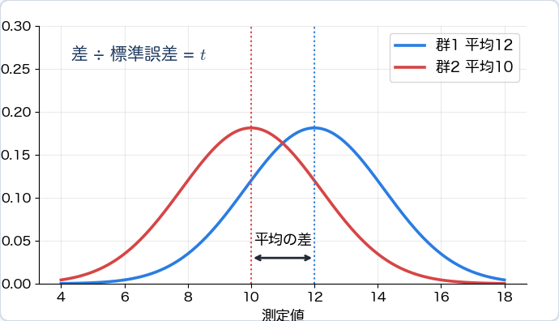
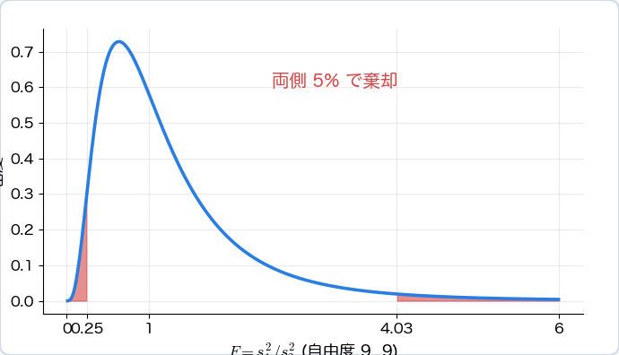
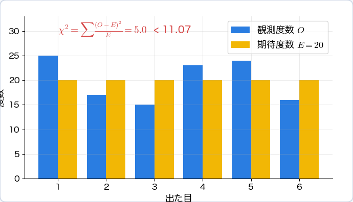
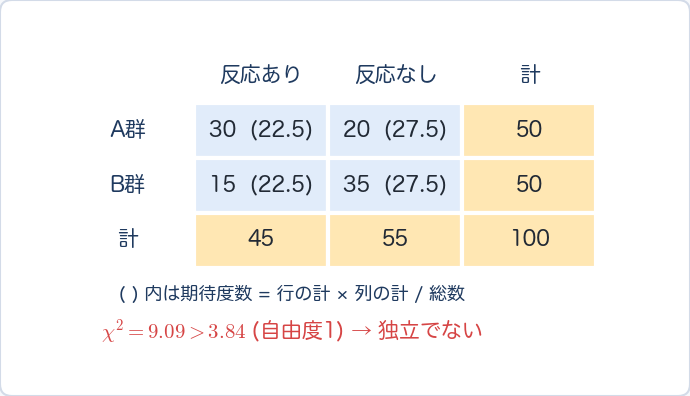
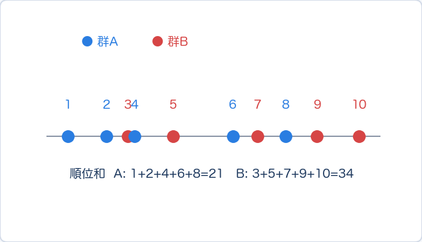
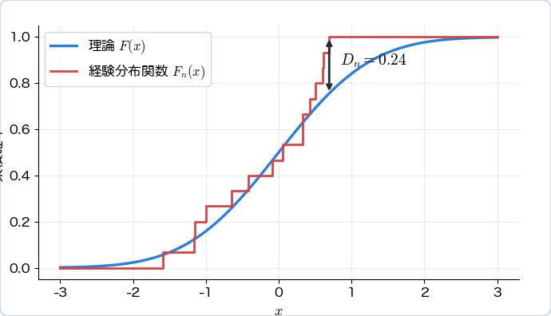
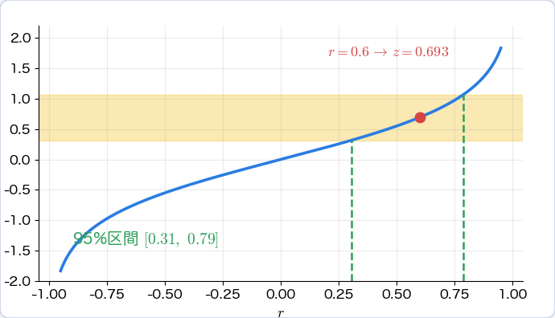

# 第7回　いろいろな検定

> **この回の学習目標**
>
> - 平均・分散・度数・順位・相関の検定を、前提条件と検定統計量の分布とセットで使い分けられる
> - $\chi^2$ 検定の自由度の数え方を間違えない
> - ノンパラメトリック検定が必要な場面を判断できる

## 1. 平均の差の検定（$t$ 検定）

| 場面 | 統計量 | 分布 |
|---|---|---|
| 1 標本 | $t=\dfrac{\bar x-\mu_0}{s/\sqrt n}$ | $t_{n-1}$ |
| 2 標本・等分散 | $t=\dfrac{\bar x_1-\bar x_2}{s_p\sqrt{1/n_1+1/n_2}}$ | $t_{n_1+n_2-2}$ |
| 2 標本・等分散を仮定しない（ウェルチ） | $t=\dfrac{\bar x_1-\bar x_2}{\sqrt{s_1^2/n_1+s_2^2/n_2}}$ | 自由度は近似式（ウェルチ・サタースウェイト） |
| 対応あり | 差 $d_i$ の 1 標本 $t$ 検定 | $t_{n-1}$ |

合併分散 $s_p^2=\dfrac{(n_1-1)s_1^2+(n_2-1)s_2^2}{n_1+n_2-2}$。迷ったらウェルチの検定が安全です。

## 2. 等分散性の検定

2 つの母分散が等しいか（$H_0:\sigma_1^2=\sigma_2^2$）は

$$F=\frac{s_1^2}{s_2^2}\sim F_{n_1-1,\ n_2-1}$$

で検定します。両側検定では下側の点 $F_{1-\alpha/2}(m,n)=1/F_{\alpha/2}(n,m)$（自由度を入れ替えた逆数）を使います。$F$ 検定は **正規性からのずれに敏感**。3 群以上ならバートレット検定（正規性に敏感）やルビーン検定（頑健）。

## 3. 適合度検定

観測度数 $O_i$ が期待度数 $E_i$ に合っているかを検定します。

$$\chi^2=\sum_{i=1}^k\frac{(O_i-E_i)^2}{E_i}\ \sim\ \chi^2_{k-1-m}$$

（$m$：期待度数の計算のために **データから推定した母数の数**。）期待度数がどれも 5 以上が目安です。

例：サイコロを 120 回振って度数が $(25,17,15,23,24,16)$、期待度数は各 20。

$$\chi^2=\frac{25+9+25+9+16+16}{20}=5.0<\chi^2_5(0.05)=11.07$$

公平でないとは言えない。

## 4. 独立性の検定（分割表）

$r\times c$ 分割表で、行と列が独立かを調べます。**独立なら** 各セルの期待度数は

$$E_{ij}=\frac{R_iC_j}{N}\quad(\text{行の計}\times\text{列の計}\div\text{総数})$$

統計量は適合度と同じ形で、自由度は $(r-1)(c-1)$。

| | 反応あり | 反応なし | 計 |
|---|---|---|---|
| A 群 | 30 (22.5) | 20 (27.5) | 50 |
| B 群 | 15 (22.5) | 35 (27.5) | 50 |
| 計 | 45 | 55 | 100 |

（ ）は期待度数。$\chi^2=\dfrac{7.5^2}{22.5}+\dfrac{7.5^2}{27.5}+\dfrac{7.5^2}{22.5}+\dfrac{7.5^2}{27.5}\approx9.09>\chi^2_1(0.05)=3.84$ なので独立でない。期待度数が小さい 2×2 表には **フィッシャーの正確検定** を使います。

## 5. ノンパラメトリック検定

分布の形を仮定せず、データを **順位** に置き換えて使う検定です。

| 場面 | 検定 |
|---|---|
| 2 群（対応なし） | ウィルコクソンの順位和検定（マン・ホイットニーの $U$ 検定） |
| 2 群（対応あり） | ウィルコクソンの符号付順位検定、符号検定 |
| 3 群以上 | クラスカル・ウォリス検定 |
| 相関 | スピアマンの順位相関、ケンドールの $\tau$ |

全体で順位をつけ、片方の群の順位の和を統計量にします。正規分布のときでも $t$ 検定より検出力は少し落ちるだけなので、分布が怪しいときの安全な選択です。

## 6. コルモゴロフ・スミルノフ検定

分布全体の適合を、経験分布関数 $F_n(x)$ と理論の分布関数 $F(x)$ の最大の差

$$D_n=\sup_x|F_n(x)-F(x)|$$

で検定します。2 標本の分布の比較にも使えます。母数を標本から推定した場合は臨界値が変わる（リリフォース検定など）ことに注意。

## 7. 相関係数の検定

母相関 $\rho=0$ の検定は

$$t=\frac{r\sqrt{n-2}}{\sqrt{1-r^2}}\sim t_{n-2}$$

$\rho\ne0$ の仮説や信頼区間には **フィッシャーの $z$ 変換** を使います。

$$z=\tanh^{-1}r=\frac12\ln\frac{1+r}{1-r}\approx N\left(\tanh^{-1}\rho,\ \frac1{n-3}\right)$$

$z$ の区間を作って $\tanh$ で戻すと $\rho$ の信頼区間です。$n=30$, $r=0.6$ なら $z=0.693$、$z\pm1.96/\sqrt{27}=[0.316,1.070]$、逆変換して約 **[0.31, 0.79]**。

## 演習問題

### 演習1　2 標本の $t$ 検定

**問題**　2 群各 10 人、平均 12 と 10、不偏分散 4 と 6。母分散が等しいとして平均の差を 5% で検定せよ（$t_{18}(0.025)=2.101$）。

**解答**　$s_p^2=\dfrac{9\cdot4+9\cdot6}{18}=5$、標準誤差 $\sqrt{5\cdot\dfrac2{10}}=1$、$t=\dfrac{12-10}{1}=2.0$。$2.0<2.101$ なので **有意でない**（差があるとは言い切れない）。

### 演習2　独立性の検定

**問題**　A 群 30 人中 18 人、B 群 30 人中 10 人が反応あり。反応の有無は群と独立か、5% で検定せよ（$\chi^2_1(0.05)=3.84$）。

**解答**　反応ありの合計 28、なし 32。期待度数は反応あり 14、なし 16（各群）。$|O-E|=4$。

$$\chi^2=16\left(\frac1{14}+\frac1{16}+\frac1{14}+\frac1{16}\right)=16\times0.2679\approx4.29>3.84$$

5% 水準で **独立でない**。

### 演習3　自由度の数え方

**問題**　ポアソン分布への適合を調べるため、データを 0, 1, 2, 3, 4 以上の 5 カテゴリーに分け、$\lambda$ をデータから推定した。$\chi^2=6.5$。自由度と 5% での判断は（$\chi^2_3(0.05)=7.81$）。

**解答**　自由度 $=5-1-1=\mathbf3$。$6.5<7.81$ なので、ポアソン分布に従うという仮説は **棄却できない**。推定した母数の分を引き忘れて自由度 4 にしてしまうと、判断の基準がずれる。

### 演習4（発展）　対応のある $t$ 検定

**問題**　同じ 5 人の薬の投与前後の差が $+2,+3,+1,+4,+0$。平均差が 0 かを 5% で検定せよ（$t_4(0.025)=2.776$）。

**解答**　$\bar d=2$, $s_d^2=\dfrac{0+1+1+4+4}{4}=2.5$, $s_d=1.58$。$t=\dfrac{2}{1.58/\sqrt5}=2.83>2.776$ で **有意**。

## まとめ・チェックリスト

- [ ] $t$ 検定（1 標本・2 標本・ウェルチ・対応あり）を使い分けられる
- [ ] $F$ 検定・適合度・独立性の統計量と自由度（$k-1-m$、$(r-1)(c-1)$）を言える
- [ ] 順位検定・KS 検定が必要な場面を説明できる
- [ ] 相関係数の検定とフィッシャーの $z$ 変換を使える

次回：**線形回帰モデル**
