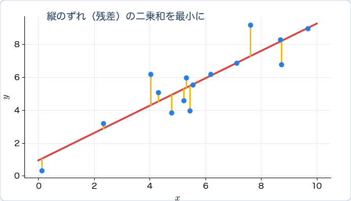
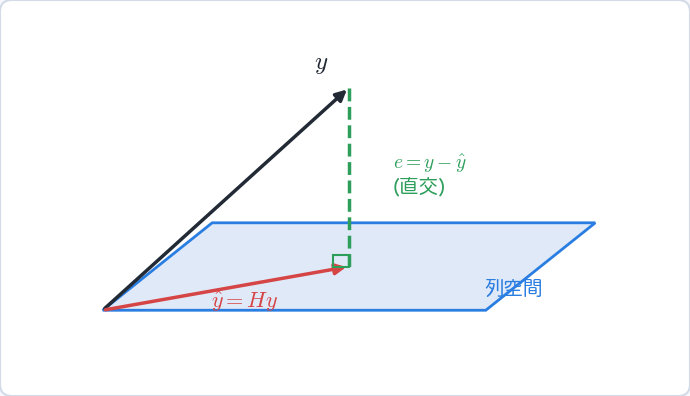
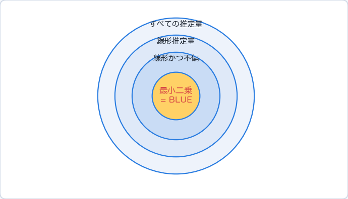
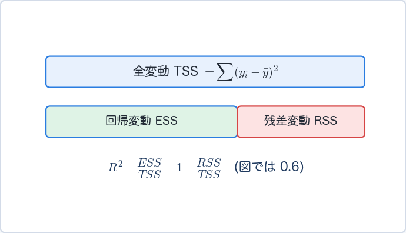
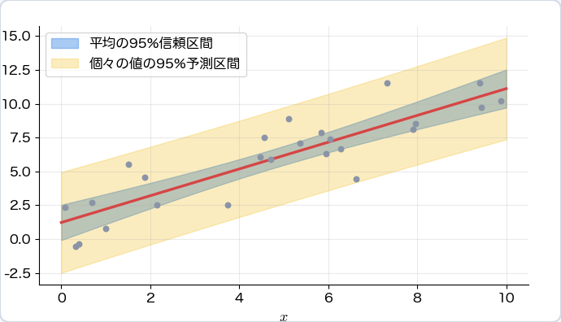
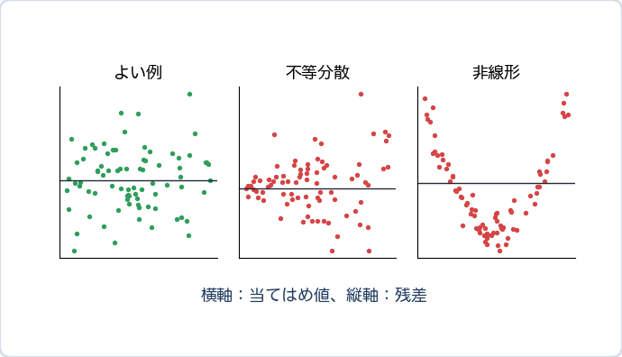
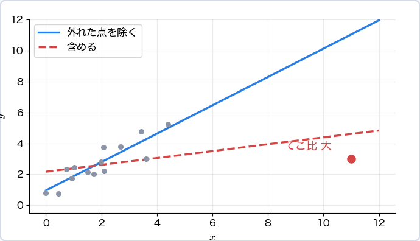
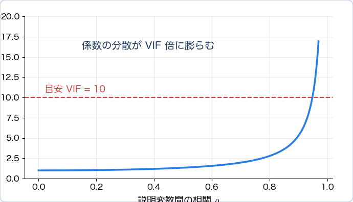
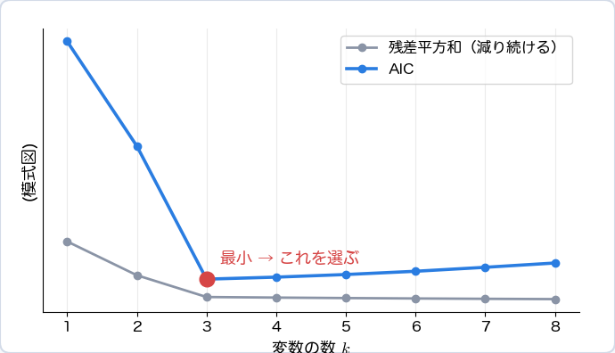
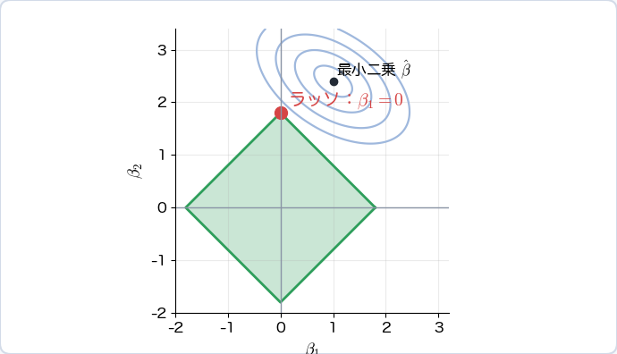

# 第8回　線形回帰モデル

> **この回の学習目標**
>
> - 最小二乗法を行列で表し、幾何学的（直交射影）に理解する
> - ガウス・マルコフの定理、分散分析表、$R^2$、係数の検定・区間推定を使える
> - 残差診断・てこ比・多重共線性・変数選択・正則化（リッジ／ラッソ）を説明できる

## 1. 単回帰と最小二乗法

$$y_i=\beta_0+\beta_1x_i+\varepsilon_i,\qquad \varepsilon_i:\ \text{平均 0・等分散 }\sigma^2\text{・互いに無相関}$$

残差の二乗和 $\sum(y_i-\beta_0-\beta_1x_i)^2$ を最小にすると

$$\hat\beta_1=\frac{S_{xy}}{S_{xx}},\qquad\hat\beta_0=\bar y-\hat\beta_1\bar x$$

（直線は必ず点 $(\bar x,\bar y)$ を通る。$S_{xy}=\sum(x_i-\bar x)(y_i-\bar y)$。）

## 2. 行列表現と正規方程式

説明変数が $p$ 個のとき、デザイン行列 $X$（第 1 列は全て 1）を使って

$$y=X\beta+\varepsilon,\qquad \hat\beta=(X^TX)^{-1}X^Ty,\qquad V[\hat\beta]=\sigma^2(X^TX)^{-1}$$

誤差分散は $\hat\sigma^2=\dfrac{RSS}{n-p-1}$。

**幾何学的な意味**：当てはめ値 $\hat y=Hy$、$H=X(X^TX)^{-1}X^T$（**ハット行列**）は、$y$ を $X$ の列が張る空間へ **直交射影** したものです。残差 $e=y-\hat y$ はその空間と直交します。この直交性が平方和の分解の基礎です。$H$ は対称で冪等（$H^2=H$）、$\mathrm{tr}(H)=p+1$。

## 3. ガウス・マルコフの定理

誤差が「平均 0・等分散・互いに無相関」（**正規性は不要**）のとき、最小二乗推定量は **データの線形関数で不偏な推定量の中で分散が最小**（BLUE: Best Linear Unbiased Estimator）です。誤差が正規分布ならさらに最尤推定量にもなります。

## 4. 分散分析表と決定係数

$$TSS=\sum(y_i-\bar y)^2=ESS+RSS$$

（全変動 = 回帰で説明される変動 + 残差変動。直交性より成立。）

- 決定係数 $R^2=\dfrac{ESS}{TSS}=1-\dfrac{RSS}{TSS}$（変数を増やすと必ず増える）
- 自由度調整済み $R^2=1-\dfrac{RSS/(n-p-1)}{TSS/(n-1)}$
- 回帰全体の検定：$F=\dfrac{ESS/p}{RSS/(n-p-1)}\sim F_{p,\,n-p-1}$（$H_0$：すべての傾きが 0）

単回帰では $R^2=r^2$（相関係数の二乗）。

## 5. 係数の検定と区間

$$t=\frac{\hat\beta_j}{\mathrm{SE}(\hat\beta_j)}\sim t_{n-p-1}\quad(H_0:\beta_j=0)$$

予測には 2 種類の区間があります。

- **平均の信頼区間**：$x$ での $E[y]$ の不確かさ（直線そのもの）
- **予測区間**：新しい 1 個の値 $y$ の範囲。誤差分散 $\sigma^2$ が加わるのでずっと広い

どちらも $x$ が $\bar x$ から離れるほど広がります。

## 6. 残差の診断

仮定（直線性・等分散・独立・正規性）が成り立つかを残差で確認します。

- **残差 vs 当てはめ値**：ランダムなら良好。ラッパ状 → 不等分散、曲線状 → 直線で不足
- **正規 Q-Q プロット**：残差の正規性
- **ダービン・ワトソン統計量**：残差の系列相関（時系列データ）

## 7. てこ比と影響力

ハット行列の対角成分 $h_{ii}$ が **てこ比**（その点の $x$ の外れ具合）。単回帰では

$$h_{ii}=\frac1n+\frac{(x_i-\bar x)^2}{S_{xx}},\qquad \sum_ih_{ii}=p+1,\qquad\text{目安 }h_{ii}>\frac{2(p+1)}{n}$$

てこ比が大きく、かつ残差も大きい点は回帰直線を強く引っ張ります。その点を除いたときの推定の変化を測るのが **クックの距離** です。

## 8. 多重共線性

説明変数どうしの相関が強いと、係数の推定が不安定（標準誤差が大きい）になります。

$$\mathrm{VIF}_j=\frac1{1-R_j^2}$$

（$R_j^2$：第 $j$ 変数を他の説明変数で回帰したときの決定係数。）目安は 10 以上で要注意。対策は変数の削除・主成分回帰・リッジ回帰。

## 9. 変数選択と情報量規準

変数を増やすほど残差は減りますが、予測が良くなるとは限りません。

$$\mathrm{AIC}=-2\ell(\hat\theta)+2k,\qquad\mathrm{BIC}=-2\ell(\hat\theta)+k\log n$$

（$k$：母数の数。**小さいほど良い**。BIC の方が変数を厳しく罰する。）ほかにマローズの $C_p$、クロスバリデーションなど。

## 10. リッジ回帰とラッソ

$$\text{リッジ：}\ \min\ RSS+\lambda\sum\beta_j^2,\qquad\text{ラッソ：}\ \min\ RSS+\lambda\sum|\beta_j|$$

- リッジは係数を縮小（制約領域は円）。$\hat\beta=(X^TX+\lambda I)^{-1}X^Ty$ で多重共線性にも強い
- ラッソは制約領域が **ひし形** で角に当たりやすく、**係数がちょうど 0 になる**（変数選択）
- $\lambda$ はクロスバリデーションで決める。ベイズ的には、リッジは正規事前分布、ラッソはラプラス事前分布の MAP 推定

## 演習問題

### 演習1　単回帰の計算

**問題**　$x=1,2,3,4,5$、$y=2,4,5,4,5$。回帰係数、決定係数、傾きの $t$ 統計量を求めよ。

**解答**　$\bar x=3,\ \bar y=4$。$S_{xx}=10$、$S_{xy}=(-2)(-2)+(-1)(0)+0+(1)(0)+(2)(1)=6$。
$\hat\beta_1=0.6$、$\hat\beta_0=4-1.8=2.2$。当てはめ値 $2.8,3.4,4.0,4.6,5.2$、残差 $-0.8,0.6,1.0,-0.6,-0.2$、$RSS=2.4$。$TSS=4+0+1+0+1=6$ なので $R^2=1-2.4/6=\mathbf{0.6}$。
$\hat\sigma^2=2.4/3=0.8$、$\mathrm{SE}(\hat\beta_1)=\sqrt{0.8/10}=0.283$、$t=0.6/0.283\approx\mathbf{2.12}$。$t_3(0.025)=3.18$ に届かず **有意でない**。

### 演習2　$F$ 統計量と調整済み決定係数

**問題**　$n=30$、説明変数 3 個の重回帰で $R^2=0.6$。$F$ と自由度調整済み決定係数を求めよ。

**解答**　$F=\dfrac{R^2/p}{(1-R^2)/(n-p-1)}=\dfrac{0.6/3}{0.4/26}=\dfrac{0.2}{0.01538}\approx\mathbf{13.0}$（$F_{3,26}(0.05)\approx2.98$ より有意）。調整済み $R^2=1-0.4\times\dfrac{29}{26}\approx\mathbf{0.554}$。

### 演習3　てこ比と VIF

**問題**　演習1 のデータで $x=5$ のてこ比と $\sum h_{ii}$。また、ある説明変数を他の変数で回帰した決定係数が 0.9 のときの VIF は。

**解答**　$h_{55}=\dfrac15+\dfrac{(5-3)^2}{10}=\mathbf{0.6}$。$\sum h_{ii}=p+1=\mathbf2$。$\mathrm{VIF}=\dfrac1{1-0.9}=\mathbf{10}$（目安の境目）。

### 演習4（発展）　直交性の利用

**問題**　最小二乗法で切片を含むとき、残差の和 $\sum e_i=0$ となることを示せ。

**解答**　$X^Te=0$（残差は $X$ の列空間と直交）で、$X$ の第 1 列は全て 1 なので $\mathbf1^Te=\sum e_i=0$。

## まとめ・チェックリスト

- [ ] $\hat\beta=(X^TX)^{-1}X^Ty$ と、直交射影・ハット行列の意味を説明できる
- [ ] ガウス・マルコフの定理の仮定（正規性は不要）を言える
- [ ] $TSS=ESS+RSS$、$R^2$、$F$ 検定、係数の $t$ 検定を計算できる
- [ ] 残差診断・てこ比・VIF の見方を説明できる
- [ ] AIC/BIC、リッジ・ラッソの違いを説明できる

次回：**一般化線形モデル**
