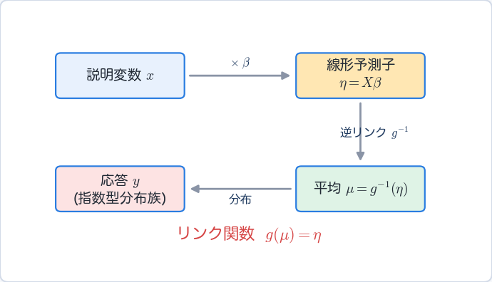
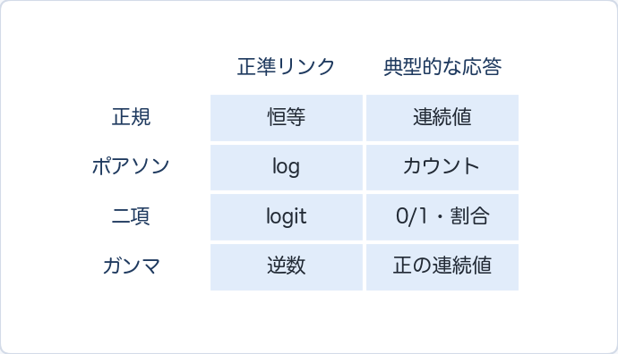
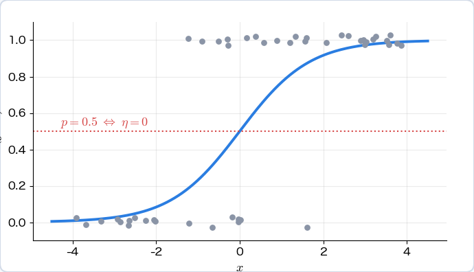
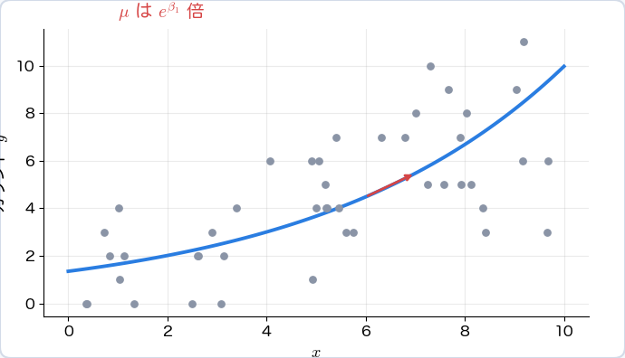
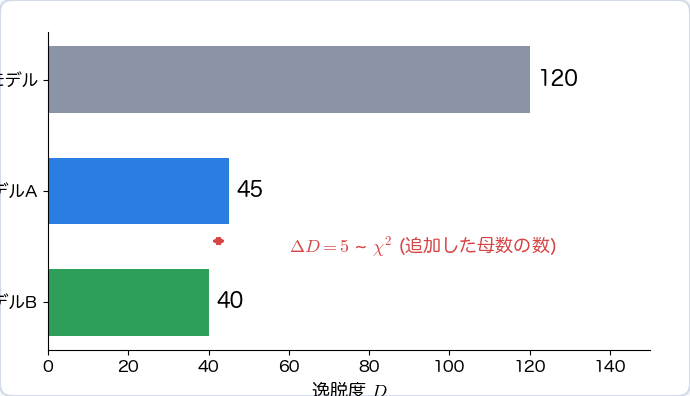
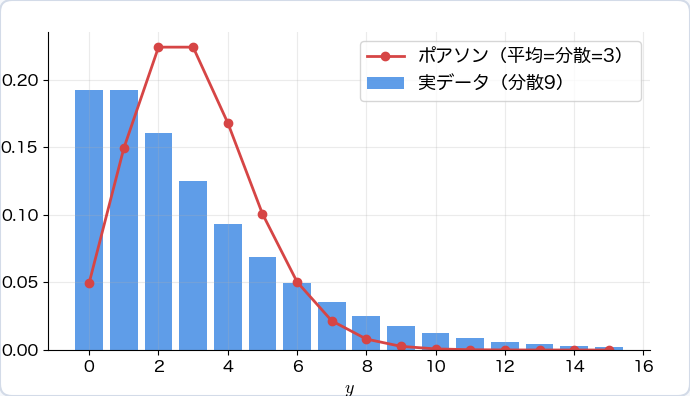
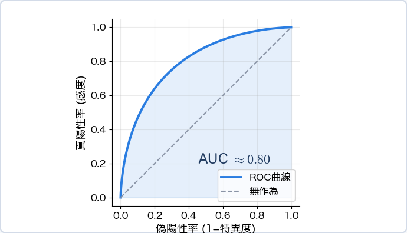

# 第9回　一般化線形モデル

> **この回の学習目標**
>
> - GLM の 3 要素（分布・線形予測子・リンク関数）を説明できる
> - ロジスティック回帰・ポアソン回帰の係数を解釈できる
> - 逸脱度によるモデル比較、過分散、ROC/AUC を理解する

## 1. GLM の 3 つの要素

線形回帰は応答が連続値で正規分布に従う場合の手法でした。応答が 0/1 や件数のときは、一般化線形モデル（GLM）を使います。

1. **応答の分布**：指数型分布族（正規・ポアソン・二項・ガンマなど）
2. **線形予測子**：$\eta=\beta_0+\beta_1x_1+\cdots+\beta_px_p$
3. **リンク関数**：平均 $\mu=E[Y]$ と線形予測子を結ぶ $g(\mu)=\eta$

確率は 0 と 1 の間、件数は正の値ですから、直線で直接表すとはみ出してしまいます。リンク関数で変換するのが GLM の発想です。**正規分布＋恒等リンク ＝ 線形回帰** で、線形回帰は GLM の特別な場合です。

## 2. 指数型分布族と正準リンク

指数型分布族の密度は

$$f(y;\theta,\phi)=\exp\left\{\frac{y\theta-b(\theta)}{a(\phi)}+c(y,\phi)\right\}$$

の形で書け、

$$E[Y]=b'(\theta),\qquad V[Y]=b''(\theta)\,a(\phi)$$

です。$\theta=\eta$ となるリンクが **正準リンク** です。

| 分布 | 正準リンク | 典型的な応答 |
|---|---|---|
| 正規 | 恒等 $g(\mu)=\mu$ | 連続値 |
| ポアソン | $\log\mu$ | カウント |
| 二項 | $\mathrm{logit}\,\mu=\log\frac{\mu}{1-\mu}$ | 0/1・割合 |
| ガンマ | 逆数 $1/\mu$ | 正の連続値 |

## 3. ロジスティック回帰

応答が 0/1（ベルヌーイ分布）、リンクはロジット：

$$\log\frac{p}{1-p}=\beta_0+\beta_1x\quad\Longleftrightarrow\quad p=\frac1{1+e^{-\eta}}$$

$\eta=0$ のとき $p=0.5$。係数が正なら $x$ が大きいほど確率が上がります。

**係数の解釈（オッズ比）**：$x$ が 1 増えると **オッズ $p/(1-p)$ が $e^{\beta_1}$ 倍** になります（確率が $e^{\beta_1}$ 倍ではない）。$\beta_1=0.7$ ならオッズは約 $e^{0.7}\approx2.01$ 倍。

**推定**：最尤法。解析的に解けないので、反復重み付き最小二乗法（IRLS）やニュートン法を使います。係数の検定はワルド検定、小標本では尤度比検定の方が信頼できます。

## 4. ポアソン回帰

件数のデータ。応答はポアソン分布、リンクは対数：

$$\log\mu=\beta_0+\beta_1x\quad\Longleftrightarrow\quad\mu=e^{\beta_0}e^{\beta_1x}$$

平均は必ず正。**$x$ が 1 増えると平均が $e^{\beta_1}$ 倍** になる、掛け算の効果です。観察期間・人口が個体ごとに違うときは、$\log t$ を **オフセット項**（係数を 1 に固定した項）として入れ、率（単位時間あたり件数）をモデル化します。

## 5. 逸脱度とモデル比較

**逸脱度**（デビアンス）は、飽和モデル（各観測値に 1 母数）との対数尤度の差の 2 倍：

$$D=2\{\ell(\text{飽和})-\ell(\text{モデル})\}$$

小さいほど当てはまりが良い。**入れ子になったモデル**（小モデルが大モデルの特別な場合）の比較では、逸脱度の差が、追加した母数の数 $q$ を自由度とする $\chi^2_q$ に漸近的に従います（尤度比検定）。AIC やピアソンの $\chi^2$ 統計量も併用します。

## 6. 過分散

ポアソン回帰は $V[Y]=E[Y]$ を仮定しますが、実データでは分散の方が大きいこと（**過分散**）がよくあります。放置すると標準誤差が過小評価され、有意になりすぎます。

- 診断：ピアソンの $\chi^2$ を残差自由度で割った値が 1 よりかなり大きい
- 対策：**準ポアソンモデル**（$V[Y]=\phi\mu$、$\phi$ を推定）、**負の二項回帰**

## 7. ROC 曲線と AUC

確率に閾値を決めて陽性・陰性に分類すると、閾値によって **感度**（真陽性率）と **特異度** が変わります。

- **ROC 曲線**：閾値を動かしながら、横軸に偽陽性率（$1-$特異度）、縦軸に真陽性率をプロット
- **AUC**（曲線の下の面積）：1 に近いほど良く、0.5 は無作為（当てずっぽう）。ランダムに選んだ陽性・陰性ペアで、陽性のスコアが高い確率とも解釈できる

## 演習問題

### 演習1　ロジスティック回帰

**問題**　$\mathrm{logit}(p)=-2+0.5x$。$x=4$ のときの $p$、$x$ が 2 増えたときのオッズ比、$x=6$ のときの $p$ を求めよ。

**解答**　$x=4$ で $\eta=0$ なので $p=\mathbf{0.5}$。$x$ が 2 増えるとロジットが $0.5\times2=1$ 増えるので **オッズ比は $e\approx2.72$**。$x=6$ で $\eta=1$、$p=\dfrac{e}{1+e}\approx\mathbf{0.731}$。

### 演習2　ポアソン回帰

**問題**　$\log\mu=0.5+0.2x$。$x=3$ での平均と、$x$ が 1 増えたときの平均の倍率は。

**解答**　$x=3$ で $\eta=1.1$、$\mu=e^{1.1}\approx\mathbf{3.00}$。倍率は $e^{0.2}\approx\mathbf{1.22}$（22% 増）。足し算でなく掛け算の変化。

### 演習3　逸脱度の比較

**問題**　モデル A の残差逸脱度 85.3（自由度 47）。変数を 2 つ追加したモデル B は 78.1（自由度 45）。5% で追加は有意か（$\chi^2_2(0.05)=5.99$）。

**解答**　$\Delta D=85.3-78.1=7.2$、自由度の差 2。$7.2>5.99$ なので **追加した 2 変数は有意**。

### 演習4（発展）　ロジスティック回帰の確率の変化

**問題**　演習1 で、$x=4$ から $x=5$ への確率の変化は何ポイントか。また、確率ではなくオッズ比で説明されるのはなぜか。

**解答**　$x=5$ で $\eta=0.5$、$p=1/(1+e^{-0.5})\approx0.622$。変化は約 $+12.2$ ポイント。確率の変化は $x$ の位置で異なる（S 字曲線）が、**オッズ比は $x$ によらず一定（$e^{0.5}$ 倍/単位）** なので、係数の解釈に使いやすい。

## まとめ・チェックリスト

- [ ] GLM の 3 要素と、線形回帰が特別な場合であることを説明できる
- [ ] 正準リンク（恒等・log・logit・逆数）を対応づけられる
- [ ] ロジスティック回帰の係数 → オッズ比、ポアソン回帰の係数 → 率の倍率を言える
- [ ] 逸脱度の差を使ったモデル比較、過分散の診断と対策を説明できる
- [ ] ROC 曲線・AUC の意味を説明できる

次回：**分散分析と実験計画法**
