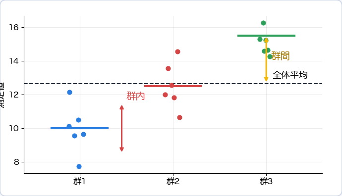
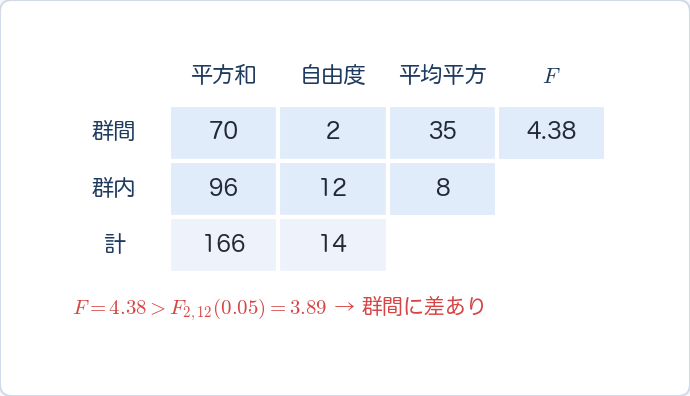
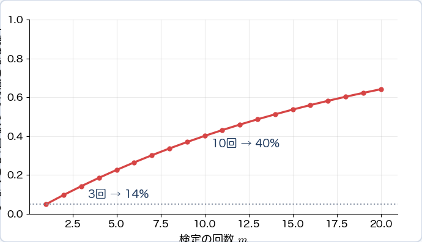
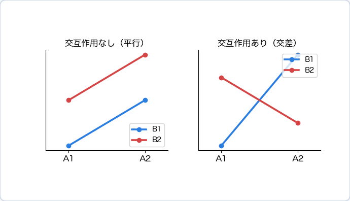
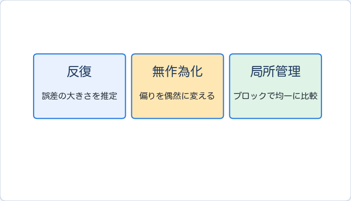
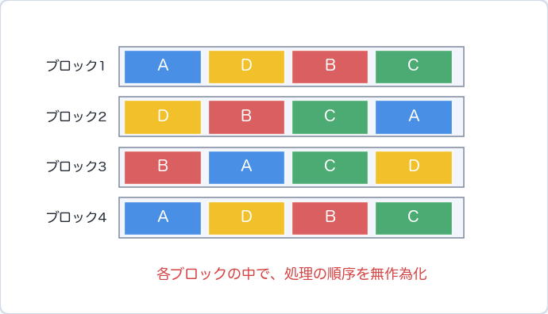
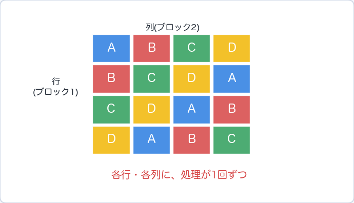
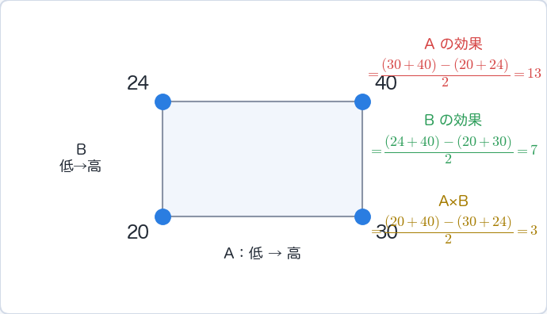
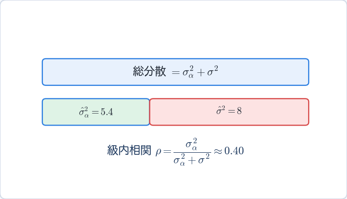

# 第10回　分散分析と実験計画法

> **この回の学習目標**
>
> - 一元配置・二元配置の分散分析と、交互作用の意味を説明できる
> - 多重比較の必要性と主な方法（ボンフェローニ・テューキーなど）を理解する
> - 実験計画の三原則、乱塊法、ラテン方格、直交表、2 水準要因実験、変量効果モデルを理解する

## 1. 一元配置分散分析

$a$ 個の群（各 $n_i$ 個、全体 $N$ 個）の平均を比べるモデル：

$$y_{ij}=\mu+\alpha_i+\varepsilon_{ij},\qquad\sum\alpha_i=0,\quad\varepsilon_{ij}\sim N(0,\sigma^2)$$

$H_0:\alpha_1=\cdots=\alpha_a=0$。全変動を **群間** と **群内** に分解します。

$$\underbrace{\sum_{ij}(y_{ij}-\bar y)^2}_{SST}=\underbrace{\sum_in_i(\bar y_i-\bar y)^2}_{SSB\ (\text{群間})}+\underbrace{\sum_{ij}(y_{ij}-\bar y_i)^2}_{SSW\ (\text{群内})}$$

それぞれを自由度で割って比をとると、$H_0$ のもとで $F$ 分布に従います。

$$F=\frac{SSB/(a-1)}{SSW/(N-a)}\sim F_{a-1,\,N-a}$$

群間が群内に比べて大きければ、平均に差があると判断します（この分解は第8回の $TSS=ESS+RSS$ と同じ構造）。

## 2. 分散分析表

| 要因 | 平方和 | 自由度 | 平均平方 | $F$ |
|---|---|---|---|---|
| 群間 | 70 | 2 | 35 | 4.38 |
| 群内 | 96 | 12 | 8 | |
| 計 | 166 | 14 | | |

平均平方 = 平方和 ÷ 自由度、$F=35/8=4.38$。$F_{2,12}(0.05)=3.89$ を超えるので、群の平均に差がある（3 群、各 5 個の例）。

## 3. 多重比較

分散分析で有意になったら、「どの群の間に差があるか」を調べたくなります。2 群ずつ $t$ 検定を繰り返すと、**少なくとも 1 回は誤って有意になる確率（FWER）が膨らみます**（有意水準 5% の独立な検定 $m$ 回で $1-0.95^m$。10 回なら約 40%）。

| 方法 | 特徴 |
|---|---|
| ボンフェローニ | 各検定の水準を $\alpha/m$ にする。簡単だが保守的 |
| テューキー（HSD） | すべての対比較に使う。スチューデント化された範囲の分布 |
| ダネット | 対照群との比較（$a-1$ 個） |
| シェッフェ | 任意の対比に使える。最も保守的 |

多数の検定では、FWER の代わりに偽発見率（FDR）を制御する方法（ベンジャミニ・ホッホベルク）もあります。

## 4. 二元配置と交互作用

因子 A（$a$ 水準）と B（$b$ 水準）、各セル $r$ 回の繰り返し：

$$y_{ijk}=\mu+\alpha_i+\beta_j+(\alpha\beta)_{ij}+\varepsilon_{ijk}$$

**交互作用 $(\alpha\beta)_{ij}$** は、一方の因子の効果が他方の因子の水準によって変わることです。各水準の平均を結んだ折れ線が **平行なら交互作用なし**、**交差・非平行なら交互作用あり**。

**繰り返しがない（$r=1$）二元配置** では、交互作用と誤差を区別できません。交互作用を調べるには各セルに繰り返しが必要です。

## 5. 実験計画の三原則（フィッシャー）

1. **反復**：同じ条件を繰り返して誤差の大きさを推定する
2. **無作為化**：割り当てを無作為にして、未知の要因の偏りを偶然に変える
3. **局所管理**（ブロック化）：似た条件の単位をブロックにまとめ、ブロック内で比較して精度を上げる

## 6. 乱塊法

実験単位が不均一なとき、似たものをブロックにまとめ、**各ブロックの中ですべての処理を 1 回ずつ無作為な順序で割り当てる** 方法です。ブロック間の差は分析で取り除かれる（処理 + ブロックの二元配置として解析）ので、処理間の比較の精度が上がります。

## 7. ラテン方格

ブロック因子が 2 つあるとき、**各行・各列にすべての処理がちょうど 1 回ずつ現れる** ように並べます。$k\times k$ の方格は $k^2$ 回の実験で、行と列の両方の影響を除いて $k$ 個の処理を比較できますが、**交互作用はないと仮定** します。

## 8. 2 水準要因実験と直交表

各因子を 2 水準（低・高）にした実験です。2 因子の 4 通りの結果から、

- A の主効果 ＝ (A が高い 2 つの結果の平均) − (A が低い 2 つの結果の平均)。B の主効果も同様
- 交互作用 $A\times B$ ＝ (両方低・両方高の平均) − (一方だけ高い 2 つの平均)

因子が増えると全組み合わせ（$2^k$ 通り）は多すぎるので、**直交表**（$L_8$ など）を使って一部の組み合わせだけを実施します。代償として、高次の交互作用が主効果と **交絡** するので、高次の交互作用は小さいという前提で使います。

## 9. 変量効果モデル

群が特定の処理ではなく、**母集団から無作為に選ばれたもの** なら、群の効果 $\alpha_i\sim N(0,\sigma_\alpha^2)$ を確率変数として扱います（変量効果モデル）。推定するのは **分散成分** $\sigma_\alpha^2$ と $\sigma^2$ で、

$$E[MSB]=\sigma^2+n\sigma_\alpha^2,\qquad E[MSW]=\sigma^2\quad\Rightarrow\quad\hat\sigma_\alpha^2=\frac{MSB-MSW}{n}$$

前の分散分析表の例では $\hat\sigma_\alpha^2=(35-8)/5=5.4$。全体のうち群で説明される割合 $\rho=\dfrac{\sigma_\alpha^2}{\sigma_\alpha^2+\sigma^2}\approx0.40$ を **級内相関** と呼びます。

## 演習問題

### 演習1　一元配置

**問題**　4 群、各 6 個。群間平方和 90、群内平方和 120。$F$ と 5% での判断を答えよ（$F_{3,20}(0.05)=3.10$）。

**解答**　自由度は群間 $4-1=3$、群内 $24-4=20$。$MSB=30$, $MSW=6$、$F=\mathbf{5.0}$。$5.0>3.10$ なので、5% 水準で **群の平均に差がある**。

### 演習2　2 水準要因実験

**問題**　2 因子 2 水準で、(A低,B低)=12、(A高,B低)=18、(A低,B高)=15、(A高,B高)=25。A の効果、B の効果、交互作用を求めよ。

**解答**
A の効果 $=\dfrac{18+25}2-\dfrac{12+15}2=21.5-13.5=\mathbf8$。
B の効果 $=\dfrac{15+25}2-\dfrac{12+18}2=20-15=\mathbf5$。
交互作用 $=\dfrac{12+25}2-\dfrac{18+15}2=18.5-16.5=\mathbf2$。

### 演習3　多重比較

**問題**　4 群の全対比較を有意水準 5% で個別に検定する。比較の数、補正なしで少なくとも 1 回誤って有意になる確率、ボンフェローニ法の水準は。

**解答**　${}_4C_2=\mathbf6$ 通り。補正なしは $1-0.95^6\approx\mathbf{0.265}$（約 26.5%）。ボンフェローニ法は各検定の水準を $0.05/6\approx\mathbf{0.0083}$ にして、全体の誤りを 5% 以下に抑える。

### 演習4（発展）　級内相関

**問題**　$MSB=35$、$MSW=8$、各群 $n=5$ のとき、分散成分と級内相関を求めよ。

**解答**　$\hat\sigma_\alpha^2=(35-8)/5=5.4$、$\hat\sigma^2=8$。$\rho=5.4/(5.4+8)\approx\mathbf{0.40}$。

## まとめ・チェックリスト

- [ ] $SST=SSB+SSW$、分散分析表と $F$ 検定を作れる
- [ ] 検定の繰り返しで第一種の誤りが膨らむ理由と、多重比較法を説明できる
- [ ] 主効果と交互作用（平行・交差）を区別できる
- [ ] 三原則、乱塊法、ラテン方格、直交表（交絡）の意味を説明できる
- [ ] 母数模型と変量模型の違い、分散成分の推定ができる

次回：**ベイズ統計**
