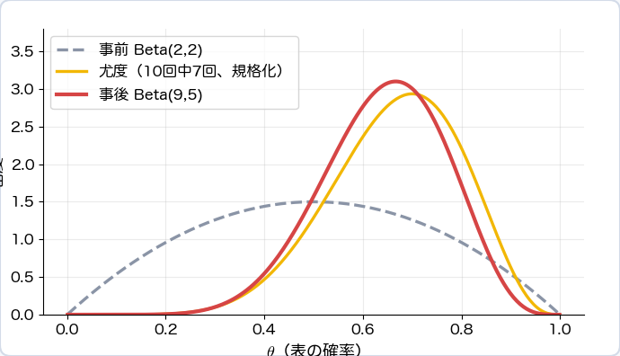
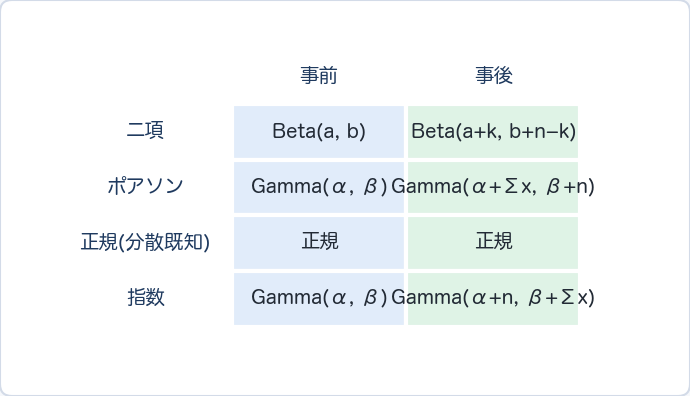
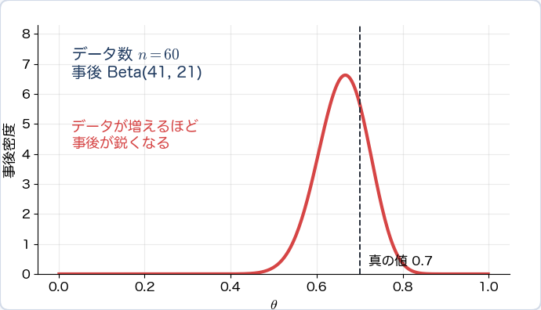
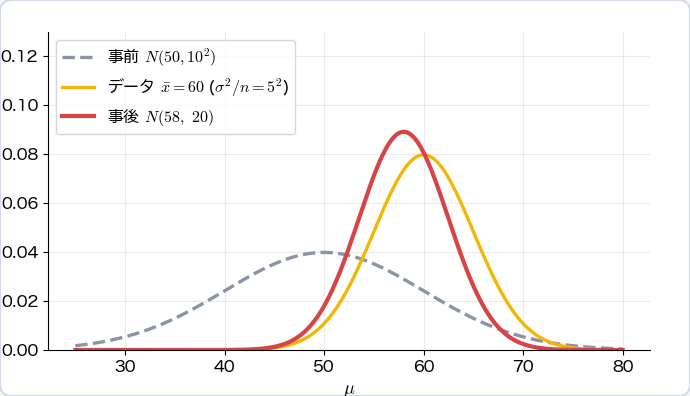
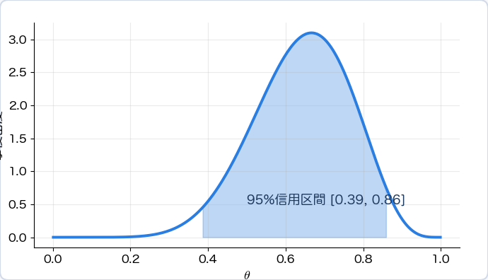
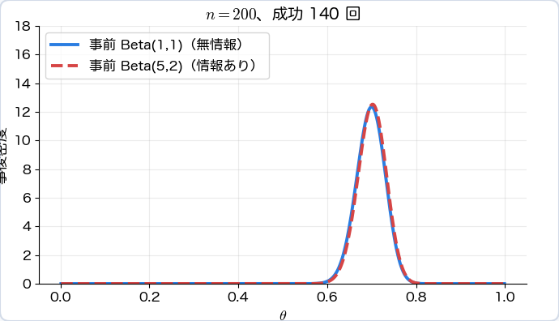
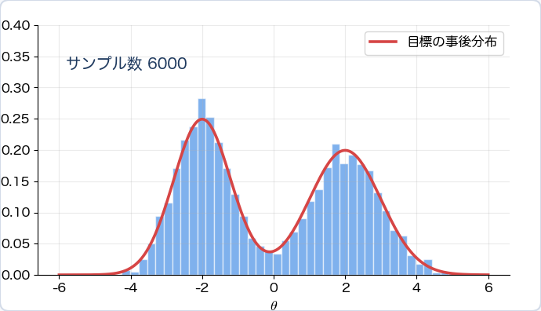
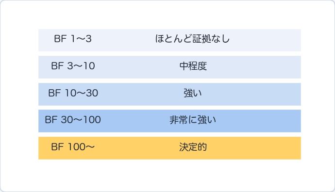

# 第11回　ベイズ統計

> **この回の学習目標**
>
> - 事前分布・尤度・事後分布の関係を説明し、共役事前分布で事後分布を計算できる
> - 点推定（事後平均・MAP）、信用区間、予測分布を求められる
> - MCMC（メトロポリス・ヘイスティングス、ギブス）とベイズ因子の考え方を理解する

## 1. ベイズ統計の枠組み

頻度論では母数 $\theta$ は固定された未知の定数ですが、ベイズ統計では **母数にも確率分布を与えます**。データを見る前の分布が **事前分布** $\pi(\theta)$、データ $x$ を見た後の分布が **事後分布** $\pi(\theta\mid x)$ です。ベイズの定理（第1回）より

$$\pi(\theta\mid x)=\frac{f(x\mid\theta)\pi(\theta)}{\int f(x\mid\theta)\pi(\theta)d\theta}\ \propto\ \underbrace{f(x\mid\theta)}_{\text{尤度}}\ \times\ \underbrace{\pi(\theta)}_{\text{事前}}$$

分母は $\theta$ によらない定数（**周辺尤度**）で、事後分布は「尤度 × 事前分布」の形が分かれば決まります。コインの例では、事前分布の山がデータ（尤度）に引っ張られて、事後分布は両者の中間にできます。

## 2. 共役事前分布

事前分布と事後分布が **同じ分布族** になる組み合わせを共役事前分布と呼びます。母数の更新が足し算で済みます。

| データの分布 | 事前分布 | 事後分布 |
|---|---|---|
| 二項（$n$ 回中 $k$ 回成功） | $\mathrm{Beta}(a,b)$ | $\mathrm{Beta}(a+k,\ b+n-k)$ |
| ポアソン | $\mathrm{Gamma}(\alpha,\beta)$（率 $\beta$） | $\mathrm{Gamma}(\alpha+\sum x_i,\ \beta+n)$ |
| 正規（分散既知）の平均 | 正規 | 正規 |
| 指数（率） | $\mathrm{Gamma}(\alpha,\beta)$ | $\mathrm{Gamma}(\alpha+n,\ \beta+\sum x_i)$ |

## 3. ベータ・二項モデル

事前 $\mathrm{Beta}(a,b)$、$n$ 回中 $k$ 回成功のとき、事後は $\mathrm{Beta}(a+k,\,b+n-k)$。

$$\text{事後平均}=\frac{a+k}{a+b+n}=\underbrace{\frac{a+b}{a+b+n}}_{\text{重み}}\cdot\frac{a}{a+b}+\underbrace{\frac{n}{a+b+n}}_{\text{重み}}\cdot\frac kn$$

**事前平均と標本比率の加重平均** で、データが多いほど標本比率の重みが大きくなります。データを追加するたびに事後が鋭くなり、真の値に集まっていきます（逐次更新）。

## 4. 正規・正規モデル

分散 $\sigma^2$ が既知の正規分布の平均 $\mu$ について、事前 $N(\mu_0,\tau_0^2)$、標本平均 $\bar x$（分散 $\sigma^2/n$）のとき、**精度（分散の逆数）で考える** と簡単です。

$$\frac1{\tau^2}=\frac1{\tau_0^2}+\frac n{\sigma^2},\qquad\mu_{\text{post}}=\frac{\mu_0/\tau_0^2+n\bar x/\sigma^2}{1/\tau_0^2+n/\sigma^2}$$

事後精度は **事前の精度とデータの精度の和**、事後平均は精度で重み付けした平均です。事前があいまい（$\tau_0$ が大きい）ほどデータの影響が大きくなります。

## 5. ベイズ推定と信用区間

事後分布から次の点推定量を取り出せます。

- **事後平均**（二乗損失のもとで最適）、**事後中央値**（絶対損失）
- **MAP 推定値**（事後分布の最頻値、$\mathrm{Beta}(a,b)$ なら $\frac{a-1}{a+b-2}$）

**95% 信用区間** は、事後確率が 95% の区間です。「母数がこの区間に入る確率が 95%」と **そのまま言える** のが信頼区間との違いです。密度の高い点を集めた最短の区間を **HPD 区間** と呼びます。

## 6. 事前分布の選択

事前知識がないときは **無情報事前分布**（一様分布やジェフリーズの事前分布 $\pi(\theta)\propto\sqrt{I(\theta)}$）を使います。データが少ないうちは事前分布の影響が大きいのですが、**データが増えると影響は薄れます**。事前分布を変えて結果が安定しているか確かめる（感度分析）のが実務の定石です。

## 7. 予測分布

将来のデータ $x_{new}$ の予測は、母数の事後分布で平均します。

$$f(x_{new}\mid x)=\int f(x_{new}\mid\theta)\,\pi(\theta\mid x)\,d\theta$$

母数を 1 つの値に決めてしまわず、**母数の不確かさも含めて** 予測します。ベータ・二項モデルで次の 1 回が成功する確率は事後平均 $\dfrac{a+k}{a+b+n}$（$a=b=1$ ならラプラスの継起の規則）。

## 8. MCMC

事後分布が複雑で積分できないとき、事後分布からのサンプルを生成して近似します（マルコフ連鎖モンテカルロ法）。

- **メトロポリス・ヘイスティングス法**：現在の位置から候補を提案し、事後密度の比に応じて採択・棄却する。定常分布が目標の事後分布になる
- **ギブスサンプリング**：各母数を、他を固定した **条件付き事後分布** から順に生成する
- 実用では、最初の部分を捨てる **バーンイン** と、複数の連鎖が一致しているかの **収束診断**（$\hat R$ など）が必要

## 9. ベイズ因子とモデル比較

2 つのモデルの **周辺尤度** の比がベイズ因子です。

$$BF_{10}=\frac{m(x\mid M_1)}{m(x\mid M_0)},\qquad m(x\mid M)=\int f(x\mid\theta)\pi(\theta)\,d\theta$$

大きいほど $M_1$ を支持します（目安：1〜3 ほとんど証拠なし、3〜10 中程度、10〜30 強い、30〜100 非常に強い、100 以上 決定的）。事前確率が等しければ事後モデル確率に直結します。BIC はベイズ因子の大標本近似で、ほかに DIC・WAIC などの情報量規準も使われます。

## 演習問題

### 演習1　ベータ・二項モデル

**問題**　事前分布は一様 $\mathrm{Beta}(1,1)$。10 回中 7 回成功。事後分布、事後平均、MAP 推定値、事後分散を求めよ。

**解答**　事後は $\mathrm{Beta}(1+7,\ 1+3)=\mathbf{Beta(8,4)}$。事後平均 $\dfrac{8}{12}\approx\mathbf{0.667}$。MAP $=\dfrac{8-1}{8+4-2}=\mathbf{0.7}$（最尤推定値に一致）。事後分散 $\dfrac{ab}{(a+b)^2(a+b+1)}=\dfrac{32}{144\times13}\approx\mathbf{0.0171}$。

### 演習2　ガンマ・ポアソンモデル

**問題**　ポアソン分布の率 $\lambda$ の事前分布は $\mathrm{Gamma}$（形状 2、率 1）。5 個のデータで合計 15。事後分布と平均・分散は。

**解答**　形状 $2+15=17$、率 $1+5=6$ より $\mathbf{Gamma(17,6)}$。平均 $17/6\approx\mathbf{2.83}$、分散 $17/6^2\approx\mathbf{0.472}$。標本平均 3 と事前平均 2 の間に入る。

### 演習3　正規・正規モデル

**問題**　平均の事前分布 $N(100,15^2)$。9 個のデータで標本平均 110、母標準偏差 15（既知）。事後平均と事後分散を求めよ。

**解答**　事前の精度 $1/225$、データの精度 $9/225$。合わせて $10/225$ なので **事後分散 $=22.5$**。事後平均は精度 $1:9$ の加重平均で $\dfrac{100+9\times110}{10}=\mathbf{109}$。

### 演習4（発展）　予測分布

**問題**　演習1 の事後分布で、次の 1 回が成功する確率は。

**解答**　事後平均に等しく $8/12\approx\mathbf{0.667}$。（最尤推定の 0.7 とは異なる点に注意。）

## まとめ・チェックリスト

- [ ] 事後 ∝ 尤度 × 事前 を説明できる
- [ ] 共役事前分布（ベータ・二項、ガンマ・ポアソン、正規・正規）で事後を計算できる
- [ ] 信用区間と信頼区間の違い、MAP・事後平均を説明できる
- [ ] 予測分布、MCMC（MH・ギブス）、ベイズ因子の考え方を説明できる

次回：**多変量解析**
