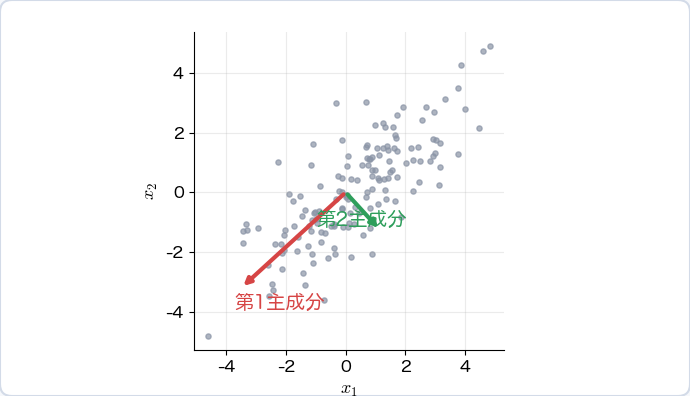
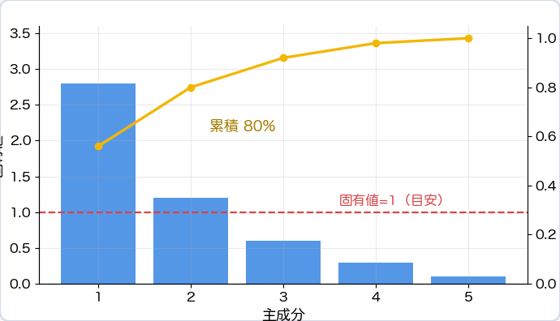
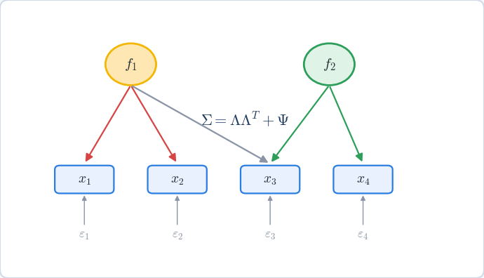
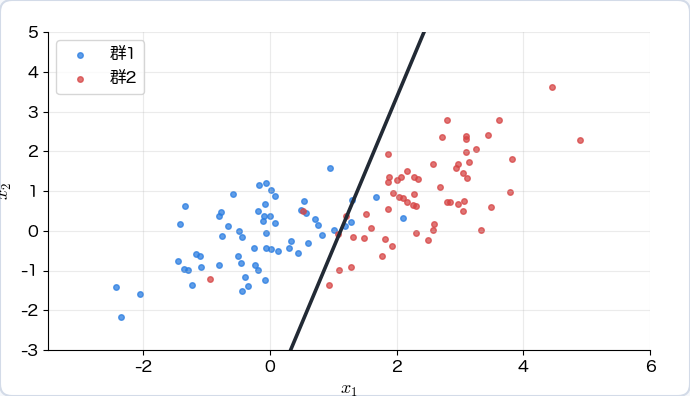
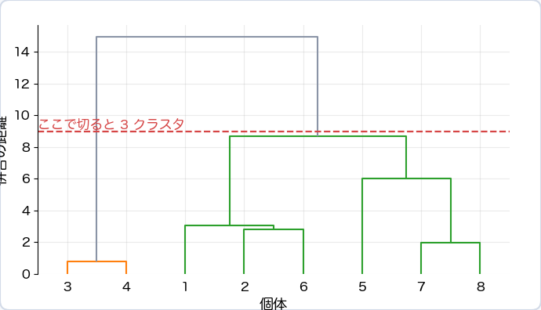
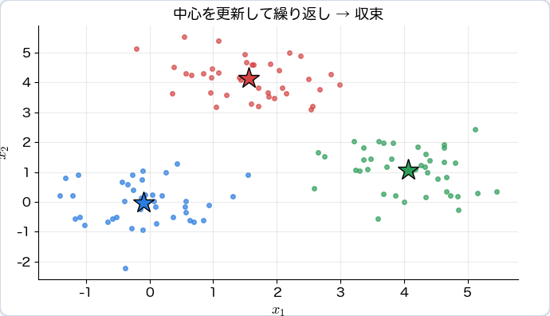
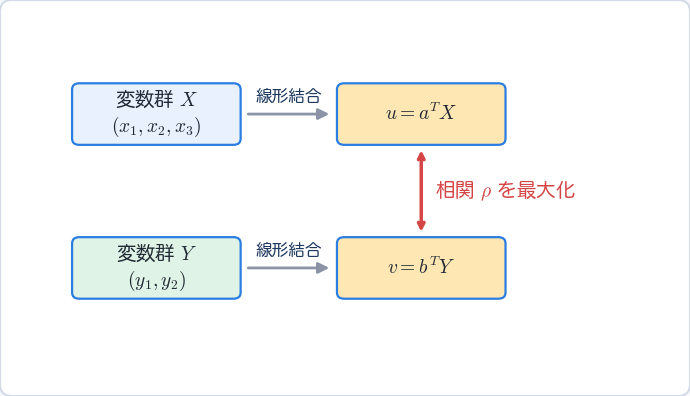
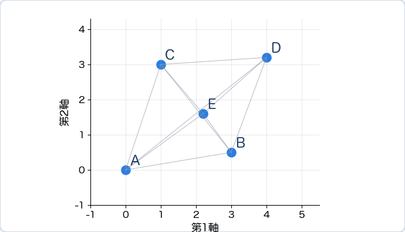

# 第12回　多変量解析

> **この回の学習目標**
>
> - 主成分分析を固有値分解として理解し、寄与率を計算できる
> - 因子分析・判別分析・正準相関分析・MDS の考え方と式を説明できる
> - 階層的クラスタリングの連結法と k-means 法の手順を説明できる

## 1. 主成分分析（PCA）

多数の変数を、情報をなるべく失わずに少数の合成変数（主成分）にまとめる方法です。第 1 主成分は **データの分散が最大になる方向** $a_1$（$\|a_1\|=1$）です。

$$\max_{\|a\|=1}\ V[a^TX]=a^T\Sigma a$$

この解は分散共分散行列 $\Sigma$ の **最大固有値に対応する固有ベクトル**、そのときの分散が固有値 $\lambda_1$ です。第 2 主成分は第 1 主成分と直交する方向の中で分散が最大のもの（$\lambda_2$ に対応する固有ベクトル）、…と続きます。主成分どうしは無相関です。

## 2. 寄与率と解釈

$$\text{寄与率}=\frac{\lambda_k}{\sum_j\lambda_j},\qquad\text{累積寄与率}=\frac{\sum_{j\le k}\lambda_j}{\sum_j\lambda_j}$$

- 使う主成分の数の目安：**累積寄与率 80% 程度**、または固有値が 1 以上（相関行列のとき）。固有値を大きい順に並べた図が **スクリープロット**
- 単位が異なる変数は標準化して **相関行列** から主成分を求める（このとき固有値の合計は変数の数 $p$）
- 主成分と元の変数の相関（因子負荷量）で、各主成分の意味を解釈する

## 3. 因子分析

観測変数の背後にある **共通因子** を考えるモデルです。

$$X=\Lambda f+\varepsilon,\qquad\Sigma=\Lambda\Lambda^T+\Psi$$

（$\Lambda$：因子負荷量行列、$f$：共通因子、$\varepsilon$：独自因子、$\Psi$：独自分散の対角行列。）

- 主成分分析は「変数から合成変数を作る」、因子分析は「**変数が因子から生じる**」というモデル
- 因子は回転しても $\Sigma=\Lambda\Lambda^T+\Psi$ が変わらない（不定性）ので、解釈しやすいようにバリマックス回転（直交）やプロマックス回転（斜交）を行う

## 4. 判別分析

あらかじめ群が分かっているデータから、新しい個体の群を判別します。各群が **等しい共分散行列** の正規分布に従うと仮定すると、判別の方向は

$$w=\Sigma^{-1}(\mu_1-\mu_2),\qquad\text{境界：}\ w^T\left(x-\frac{\mu_1+\mu_2}{2}\right)=0$$

（**線形判別分析**）。$w^T(x-m)>0$ なら群 1 に判別します。共分散が群ごとに異なると境界が曲線になり、**二次判別分析** を使います。誤判別率は交差検証で評価します。

## 5. 階層的クラスタリング

群が未知のデータを、似たもの同士で分けます。近い個体（クラスタ）から順に併合し、結果を **デンドログラム（樹形図）** で表します。クラスタ間の距離の測り方（連結法）：

| 連結法 | クラスタ間距離 |
|---|---|
| 単連結（最短距離法） | 最も近い点どうしの距離（鎖状につながりやすい） |
| 完全連結（最長距離法） | 最も遠い点どうしの距離 |
| 群平均法 | すべての点対の平均距離 |
| ウォード法 | 併合による平方和の増加が最小になる組を併合 |

ある高さでデンドログラムを切るとクラスタが決まります。

## 6. k-means 法

クラスタ数 $k$ を先に決める非階層的な方法です。

1. 適当な $k$ 個の中心を置く
2. 各点を最も近い中心に割り当てる
3. 各クラスタの重心に中心を更新する
4. 2, 3 を変化がなくなるまで繰り返す

クラスタ内平方和は単調に減少しますが **局所解** に陥るため、初期値を変えて複数回実行します。$k$ の決め方：エルボー法、シルエット係数。

## 7. 正準相関分析

2 組の変数群 $X$, $Y$ から、それぞれの線形結合 $u=a^TX$, $v=b^TY$ を作り、**その相関が最大** になるようにします。第 1 正準相関が最大の相関で、次の組は以前の組と無相関という条件で順に求めます。**正準相関係数の二乗** は、共分散行列から作る行列 $\Sigma_{XX}^{-1}\Sigma_{XY}\Sigma_{YY}^{-1}\Sigma_{YX}$ の固有値に等しくなります。重回帰（目的変数が 1 つ）の拡張です。

## 8. 多次元尺度構成法（MDS）

個体間の **距離（非類似度）の情報だけ** から、低次元の配置（地図）を求めます。古典的 MDS は距離行列から内積行列（二重中心化）を作って固有値分解します。ユークリッド距離ならば主成分分析と同じ結果になります。向きや反転は決まりません。

## 演習問題

### 演習1　主成分分析

**問題**　共分散行列が $\begin{pmatrix}4&2\\2&3\end{pmatrix}$ のとき、固有値と第 1 主成分の寄与率を求めよ。

**解答**　トレース $=7$、行列式 $=12-4=8$。固有方程式 $\lambda^2-7\lambda+8=0$ より $\lambda=\dfrac{7\pm\sqrt{17}}2\approx\mathbf{5.56,\ 1.44}$。寄与率 $5.56/7\approx\mathbf{0.79}$。

### 演習2　線形判別

**問題**　2 群の平均が $\mu_1=(2,0)^T$, $\mu_2=(0,0)^T$、共通の共分散行列 $\Sigma=\begin{pmatrix}1&0.5\\0.5&1\end{pmatrix}$。判別の方向 $w$ と、点 $(1.5,\,0.5)$ がどちらの群に判別されるかを答えよ。

**解答**　$\Sigma^{-1}=\dfrac1{0.75}\begin{pmatrix}1&-0.5\\-0.5&1\end{pmatrix}$。$\mu_1-\mu_2=(2,0)^T$ より $w=\dfrac1{0.75}(2,\,-1)^T=\left(\dfrac83,\,-\dfrac43\right)^T$。中点 $m=(1,0)^T$。
$x-m=(0.5,0.5)$ なので $w^T(x-m)=\dfrac43-\dfrac23=\dfrac23>0$。**群 1** に判別。

### 演習3　連結法

**問題**　1 次元の 5 点 $\{1,2,6,7,12\}$ をユークリッド距離で階層的に併合する。単連結と完全連結の「最後の併合の距離」を求めよ。

**解答**
単連結：$\{1,2\}$（距離 1）、$\{6,7\}$（1）、続いて 2 と 6 の距離 4 で併合、最後に 12 が 7 との距離 5 で併合 → **5**。
完全連結：$\{1,2\}$（1）、$\{6,7\}$（1）、$\{1,2\}$–$\{6,7\}$ は最遠の 1 と 7 の距離 6、最後に 12 と 1 の距離 11 → **11**。

### 演習4（発展）　相関行列の固有値

**問題**　3 変数の相関行列の固有値が $2.1,\ 0.6,\ x$ のとき、$x$ と第 1 主成分の寄与率を求めよ。

**解答**　相関行列の固有値の合計は変数の数 3 なので $x=0.3$。寄与率 $2.1/3=\mathbf{0.70}$。

## まとめ・チェックリスト

- [ ] 主成分分析 = 共分散行列の固有値分解、寄与率・累積寄与率の計算
- [ ] 主成分分析と因子分析のモデルの違いを説明できる
- [ ] 線形判別の方向 $w=\Sigma^{-1}(\mu_1-\mu_2)$ と判別境界を計算できる
- [ ] 連結法（単・完全・群平均・ウォード）と k-means の手順を説明できる
- [ ] 正準相関・MDS の目的を説明できる

次回：**時系列解析**
