# 第13回　時系列解析

> **この回の学習目標**
>
> - 定常性・自己相関を説明し、AR・MA・ARMA・ARIMA モデルの性質（分散・自己相関）を導出できる
> - コレログラム（ACF/PACF）から次数を同定し、単位根・予測・残差診断の考え方を理解する
> - 状態空間モデル・カルマンフィルタ・ARCH/GARCH の概要を押さえる

## 1. 時系列の構成要素

時系列は **トレンド $T_t$**、**季節変動 $S_t$**、不規則変動 $\varepsilon_t$ に分けて考えます。

- 加法モデル $y_t=T_t+S_t+\varepsilon_t$、乗法モデル $y_t=T_tS_t\varepsilon_t$（対数を取ると加法モデル）
- トレンドは **移動平均** で取り出す。季節の周期と同じ長さの移動平均を使うと、季節変動が打ち消される
- 季節調整は、取り出した季節成分を取り除く操作

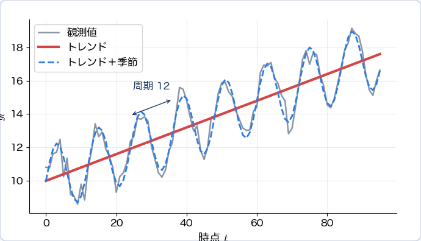

## 2. 定常性と自己相関

時系列を統計的に扱うには **定常性** が必要です。**弱定常** とは、

$$E[X_t]=\mu\ (\text{一定}),\qquad V[X_t]=\sigma_X^2\ (\text{一定}),\qquad\mathrm{Cov}(X_t,X_{t+h})=\gamma(h)\ (\text{ラグ }h\text{ のみに依存})$$

のこと。**自己相関係数** $\rho(h)=\gamma(h)/\gamma(0)$ を縦軸、ラグ $h$ を横軸にした図が **コレログラム**。互いに無相関で分散が一定の系列を **白色雑音** と呼び、あらゆるモデルの部品になります。

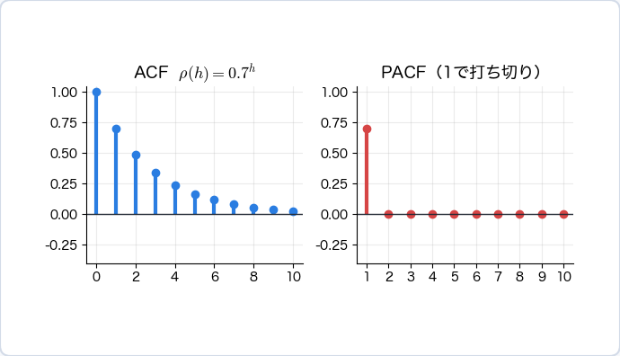

## 3. AR 過程

**AR(1)**：$X_t=\phi X_{t-1}+\varepsilon_t$（$\varepsilon_t$ は白色雑音、分散 $\sigma^2$）。

- **定常条件 $|\phi|<1$**
- 平均 0、分散 $V[X_t]=\dfrac{\sigma^2}{1-\phi^2}$、自己相関 $\rho(h)=\phi^{h}$（指数的に減衰）

導出：$V[X_t]=\phi^2V[X_{t-1}]+\sigma^2$ で定常なら $V=\phi^2V+\sigma^2$。

**AR($p$)** は特性方程式 $1-\phi_1z-\cdots-\phi_pz^p=0$ の根がすべて **単位円の外側** にあるとき定常。偏自己相関（PACF）はラグ $p$ で打ち切られます。

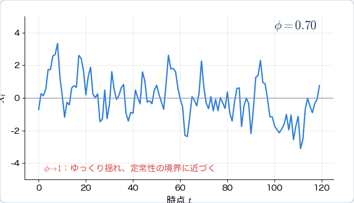

## 4. MA 過程

**MA(1)**：$X_t=\varepsilon_t+\theta\varepsilon_{t-1}$。有限個の雑音の和なので **常に定常**。

$$V[X_t]=(1+\theta^2)\sigma^2,\qquad\rho(1)=\frac{\theta}{1+\theta^2},\qquad\rho(h)=0\ (h\ge2)$$

つまり **自己相関がラグ $q$ で打ち切られ**、偏自己相関は減衰します。$|\theta|<1$ のとき **反転可能**（AR($\infty$) に書き直せる）。

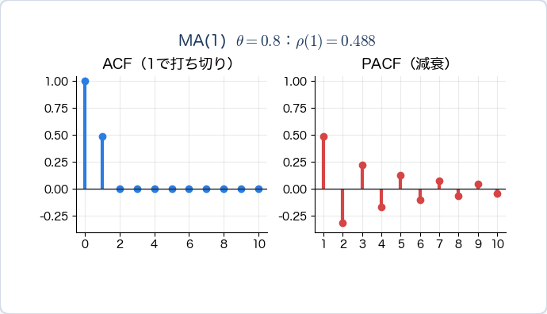

## 5. 次数の同定

| モデル | 自己相関（ACF） | 偏自己相関（PACF） |
|---|---|---|
| AR($p$) | 減衰 | $p$ で打ち切り |
| MA($q$) | $q$ で打ち切り | 減衰 |
| ARMA | 減衰 | 減衰 |

実際のデータではっきりしないことも多く、AIC などで候補を比べます。

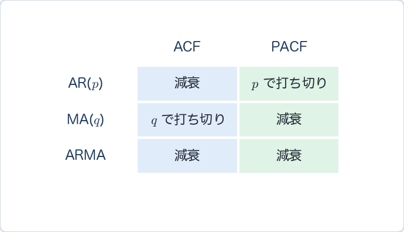

## 6. ARMA と ARIMA

**ARMA($p,q$)** は AR と MA の組合せで、少ない母数で表現できます。トレンドのある **非定常** な系列は **差分** $\nabla X_t=X_t-X_{t-1}$ を取って定常にします。$d$ 回差分した系列に ARMA を当てはめたものが **ARIMA($p,d,q$)** です。ランダムウォーク $X_t=X_{t-1}+\varepsilon_t$ は ARIMA(0,1,0)（1 階差分が白色雑音）。季節性があれば季節差分も使う **季節 ARIMA**。差分の取りすぎ（過剰差分）に注意。

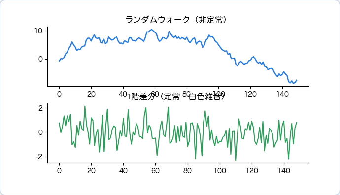

## 7. 単位根

AR(1) の $\phi=1$ を **単位根** といいます。定常系列は平均のまわりに戻りますが、単位根のある系列は **分散が時間とともに増えます**。**ディッキー・フラー検定**（$H_0$：単位根あり）で調べます。

- 検定統計量は通常の $t$ 分布に従わない（専用の臨界値表を使う）
- 無関係な単位根系列どうしを回帰すると有意に見える **見せかけの回帰** が起きる

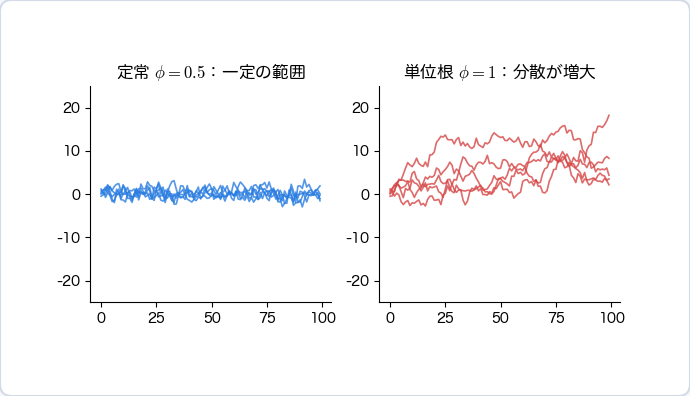

## 8. 推定と予測

AR のパラメータは自己相関から解く **ユール・ウォーカー方程式**（AR(1) なら $\hat\phi=\hat\rho(1)$）で推定でき、最尤法・条件付き最小二乗法も使います。

**AR(1) の $h$ 期先予測**（平均 $\mu$）：

$$\hat X_{T+h}=\mu+\phi^h(X_T-\mu),\qquad\text{予測誤差分散}=\sigma^2\frac{1-\phi^{2h}}{1-\phi^2}$$

先に行くほど予測値は平均に近づき、誤差分散は系列の分散 $\sigma^2/(1-\phi^2)$ に近づきます（予測区間が広がる）。

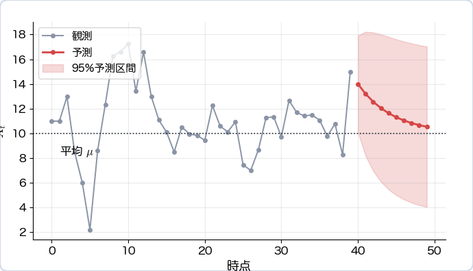

## 9. モデル選択と残差診断

候補モデルは AIC・BIC で比べます。当てはめ後、**残差が白色雑音か** を確認します。残差の自己相関がすべて $\pm1.96/\sqrt n$ の帯の内側にあればよく、まとめて検定するのが **リュング・ボックスの検定**：

$$Q=n(n+2)\sum_{k=1}^m\frac{\hat\rho_k^2}{n-k}\ \sim\ \chi^2_{m-p-q}$$

（自由度は、推定した AR・MA の母数の数を引く。）

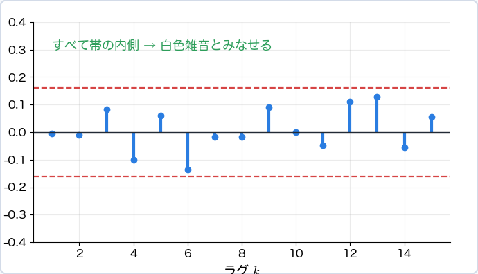

## 10. 状態空間モデルとカルマンフィルタ

観測できない **状態** が時間とともに変化し、それに雑音が加わったものを観測する、という考え方です。最も簡単な **局所水準モデル**：

$$\mu_t=\mu_{t-1}+\eta_t\ (\text{状態}),\qquad y_t=\mu_t+\varepsilon_t\ (\text{観測})$$

**カルマンフィルタ** は、新しい観測が来るたびに「予測 → 観測との差にゲインをかけて修正」を逐次繰り返して状態を推定します。ゲインは状態と観測の雑音の大きさの比で決まります。ARIMA も状態空間表現できます。

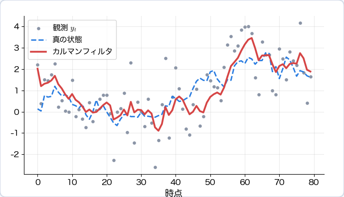

## 11. ARCH と GARCH

金融データでは変動の大きさが時間とともに変わり、大きな変動が続いて起きます（**ボラティリティの集中**）。条件付き分散を過去の二乗に依存させる **ARCH(1)**：$h_t=\alpha_0+\alpha_1X_{t-1}^2$。過去の分散 $h_{t-1}$ にも依存させたものが **GARCH**。

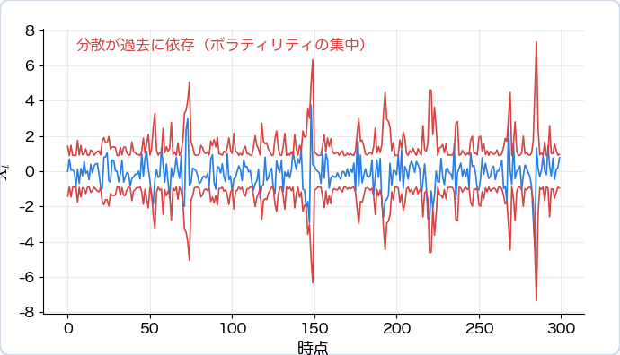

## 演習問題

### 演習1　AR(1)

**問題**　AR(1) で $\phi=0.6$、雑音の分散 $\sigma^2=1.28$。$V[X_t]$、$\rho(2)$、$\gamma(2)$ を求めよ。

**解答**　$V[X_t]=\dfrac{1.28}{1-0.36}=\mathbf{2.0}$。$\rho(2)=0.6^2=\mathbf{0.36}$。$\gamma(2)=V\cdot\rho(2)=2.0\times0.36=\mathbf{0.72}$。

### 演習2　MA(1)

**問題**　MA(1) で $\theta=0.5$。$V[X_t]$、$\rho(1)$、$\rho(2)$ を求めよ。

**解答**　$V[X_t]=(1+0.25)\sigma^2=\mathbf{1.25\sigma^2}$。$\gamma(1)=\theta\sigma^2$ より $\rho(1)=\dfrac{0.5}{1.25}=\mathbf{0.4}$。ラグ 2 以降は重なる雑音がなく $\rho(2)=\mathbf0$。

### 演習3　AR(1) の予測

**問題**　AR(1)、平均 10、$\phi=0.8$、$\sigma^2=4$。最後の観測が 15 のとき、1 期先・2 期先の予測値と、2 期先の予測誤差分散を求めよ。

**解答**　$\hat X_{T+1}=10+0.8\times5=\mathbf{14}$、$\hat X_{T+2}=10+0.64\times5=\mathbf{13.2}$。2 期先の誤差分散 $=\sigma^2(1+\phi^2)=4\times1.64=\mathbf{6.56}$。

### 演習4（発展）　定常性の判定

**問題**　$X_t=1.2X_{t-1}-0.2X_{t-2}+\varepsilon_t$ は定常か。

**解答**　特性方程式 $1-1.2z+0.2z^2=0$ を解くと $z=1,\ 5$。根の 1 つが単位円上（$z=1$）なので **定常でない**（単位根を含む）。$\nabla X_t$ が AR(1)（$\phi=0.2$）になる ARIMA(1,1,0)。

## まとめ・チェックリスト

- [ ] 弱定常の定義、自己相関、白色雑音を説明できる
- [ ] AR(1) の分散・自己相関、MA(1) の自己相関を導出できる
- [ ] ACF/PACF の打ち切り・減衰パターンから次数を同定できる
- [ ] 差分・ARIMA・単位根（DF 検定、見せかけの回帰）を説明できる
- [ ] AR(1) の予測値・予測誤差分散、リュング・ボックス検定を使える
- [ ] 状態空間モデル・カルマンフィルタ・ARCH の概要を説明できる

次回：**標本調査法**（最終回）
