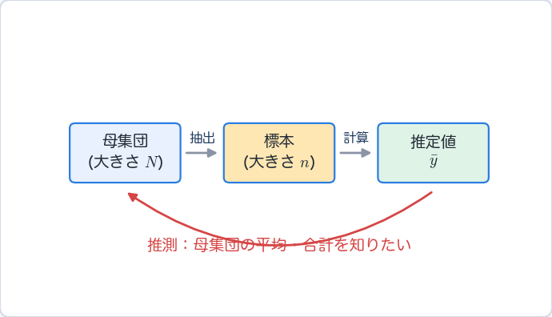
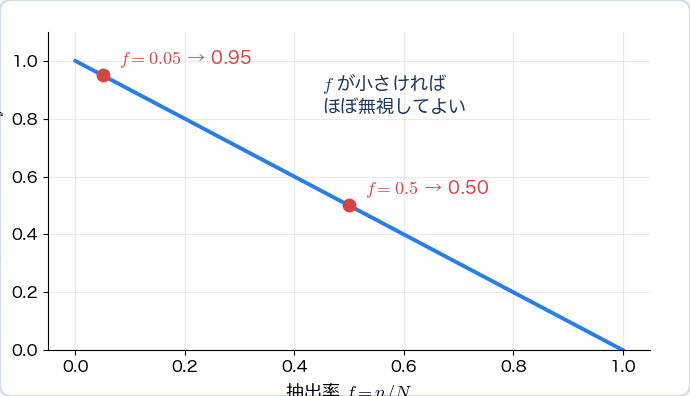
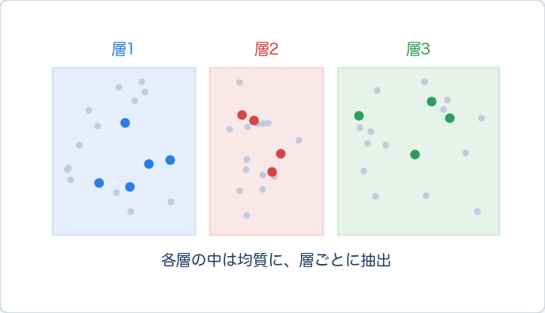
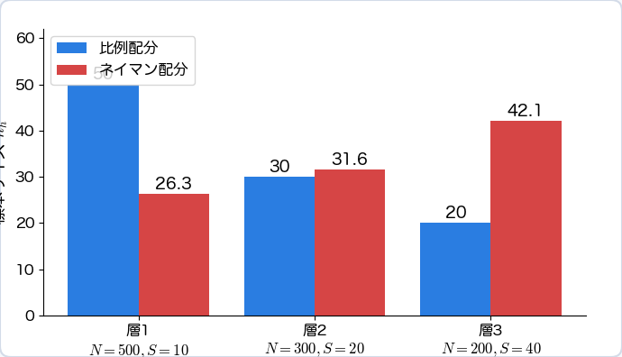
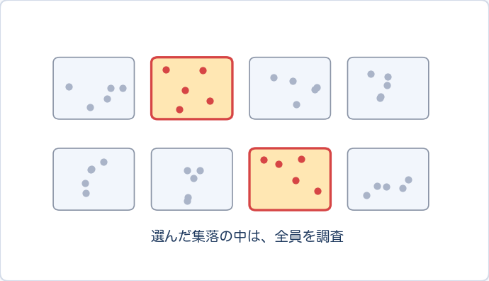
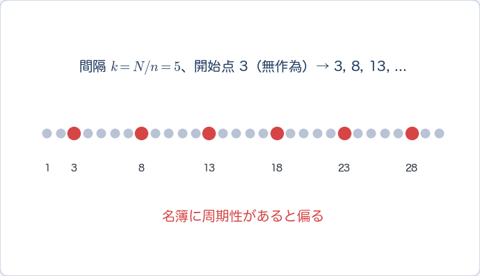
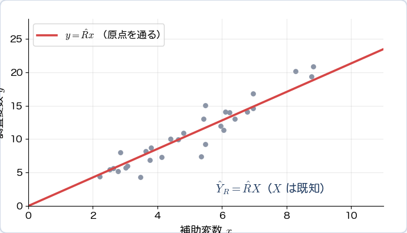

# 第14回　標本調査法

> **この回の学習目標**
>
> - 単純無作為抽出の推定量・分散・有限母集団修正を計算できる
> - 層化抽出（比例配分・ネイマン配分）・集落抽出・系統抽出・多段抽出の特徴を説明できる
> - 比推定量、ホルビッツ・トンプソン推定量、非標本誤差を理解する

## 1. 標本調査の基本

**全数調査** は母集団の全員を調べ、**標本調査** は一部を調べて母集団の平均・合計・比率を推測します。誤差は 2 種類あります。

- **標本誤差**：標本の選び方による誤差。標本サイズを増やせば小さくなる。確率的に抽出するので統計的に評価できる
- **非標本誤差**：無回答、測定の誤り、母集団リストの不備（カバレッジ誤差）など。**標本サイズを増やしても減らない**

## 2. 単純無作為抽出

大きさ $N$ の母集団から、非復元で $n$ 個を等しい確率で選びます。抽出率 $f=n/N$。母平均 $\bar Y$ の推定量は標本平均 $\bar y$（不偏）、母合計 $Y=N\bar Y$ は $\hat Y=N\bar y$。

$$V[\bar y]=(1-f)\frac{S^2}{n},\qquad S^2=\frac1{N-1}\sum_{i=1}^N(Y_i-\bar Y)^2$$

$(1-f)$ が **有限母集団修正**（第1回の超幾何分布の分散の係数と同じ形）で、抽出率が小さければ（目安 5% 未満）ほぼ無視できます。$S^2$ は標本の不偏分散 $s^2$ で置き換えて

$$\hat V[\bar y]=(1-f)\frac{s^2}{n},\qquad\hat V[\hat Y]=N^2\hat V[\bar y]$$

母比率 $P$ は $\hat p$（0/1 変数の平均）で、$\hat V[\hat p]=(1-f)\dfrac{\hat p(1-\hat p)}{n-1}$。

## 3. 層化抽出

母集団を似た者どうしの **層**（$h=1,\dots,L$、大きさ $N_h$、重み $W_h=N_h/N$）に分け、層ごとに標本を取ります。

$$\bar y_{st}=\sum_hW_h\bar y_h,\qquad V[\bar y_{st}]=\sum_hW_h^2(1-f_h)\frac{S_h^2}{n_h}$$

層間の違いが誤差に入らないので、**層内が均質で層間の差が大きい** ほど単純無作為抽出より精度が上がります。分散は層ごとの分散を足すだけです。

## 4. 標本の配分

層ごとの標本サイズ $n_h$ の決め方です。

| 配分 | $n_h$ |
|---|---|
| 比例配分 | $n\dfrac{N_h}{N}$（層の大きさに比例） |
| ネイマン配分（最適配分） | $\propto N_hS_h$（ばらつきの大きい層に多く） |
| 費用を考慮 | $\propto\dfrac{N_hS_h}{\sqrt{c_h}}$（$c_h$：層 $h$ の 1 個あたり費用） |

同じ総サイズ $n$ なら、ネイマン配分が $V[\bar y_{st}]$ を最小にします。

## 5. 集落抽出

母集団が自然な集団（集落：学校・世帯・地域など）に分かれているとき、**集落を単位に抽出して、選んだ集落は全員を調べます**。名簿が個人単位でなくても実施でき、調査の手間が少ないのが利点です。

同じ集落の中は似ていることが多いので（**級内相関 $\rho$ が高い**）、精度は単純無作為抽出より悪くなりがちです。集落の大きさを $m$ として **設計効果** は $\mathrm{deff}\approx1+(m-1)\rho$。層化とは逆に、**集落内が異質で集落間が同質** なのが理想です。

## 6. 系統抽出

名簿から **等間隔** $k=N/n$ で抽出します（開始点は $1$〜$k$ から無作為）。手間が少なく、名簿がうまく並んでいれば層化抽出に近い効果もありますが、**名簿に周期性があり、その周期と間隔が重なると大きく偏ります**。

## 7. 多段抽出

全国調査のように母集団が大きいときは段階的に抽出します（例：市区町村 → 世帯）。**二段抽出** は、選んだ一次抽出単位（集落）の中でさらに **一部だけ** を選びます（集落抽出は全員を調査）。各段の確率が決まっているので最終的な包含確率が計算でき、分散は **第一段の誤差 + 第二段の誤差** からなります。

## 8. 比推定

調べたい変数 $y$ と強く関係する補助変数 $x$ があり、$x$ の母集団合計 $X$ が **既知** のとき、

$$\hat R=\frac{\bar y}{\bar x},\qquad\hat Y_R=\hat R\,X$$

（**比推定量**。標本から $y$ と $x$ の比を求め、$x$ の母合計にかける。）$x$ と $y$ の相関が高く、原点を通る直線に近いほど、単純な推定量 $N\bar y$ より分散が小さくなります。ただし **バイアスが少しある**（一致推定量）。比が一定でないときは **回帰推定量** を使います。

## 9. 包含確率と重み付け

個体 $i$ が標本に入る確率を **包含確率** $\pi_i$ と呼びます。確率が不均一な抽出（確率比例抽出など）では、**ホルビッツ・トンプソン推定量**

$$\hat Y_{HT}=\sum_{i\in s}\frac{y_i}{\pi_i}$$

が母合計の不偏推定量です。確率が小さい個体ほど多くの個体を代表する、と考えて重み $1/\pi_i$ をかけます。無回答がある場合も、回答確率を使った重み付けで偏りを補正しますが、限界があり、根本的には無回答を減らす努力が必要です。

## 演習問題

### 演習1　単純無作為抽出

**問題**　$N=1000$ から $n=100$ を非復元抽出。標本平均 50、標本不偏分散 400。平均の標準誤差と 95% 信頼区間、母合計の推定値とその標準誤差を求めよ。

**解答**　$f=0.1$。$\hat V[\bar y]=0.9\times\dfrac{400}{100}=3.6$、標準誤差 $\sqrt{3.6}\approx\mathbf{1.90}$。95% 区間 $50\pm1.96\times1.90\approx\mathbf{[46.3,\ 53.7]}$。母合計 $\hat Y=1000\times50=\mathbf{50000}$、標準誤差 $1000\times1.90\approx\mathbf{1900}$。

### 演習2　層化抽出

**問題**　2 層、重み $(0.6,0.4)$、標本サイズ $(60,40)$、層の平均 $(40,60)$、標本不偏分散 $(36,64)$。有限母集団修正は無視して、全体の平均の推定値とその標準誤差を求めよ。

**解答**　$\bar y_{st}=0.6\times40+0.4\times60=\mathbf{48}$。
$\hat V=0.6^2\cdot\dfrac{36}{60}+0.4^2\cdot\dfrac{64}{40}=0.216+0.256=0.472$、標準誤差 $\sqrt{0.472}\approx\mathbf{0.687}$。

### 演習3　ネイマン配分

**問題**　3 層、$N_h=(500,300,200)$、$S_h=(10,20,40)$、総標本サイズ 100。比例配分とネイマン配分を求めよ。

**解答**　比例配分は $(\mathbf{50,\ 30,\ 20})$。ネイマン配分は $N_hS_h=(5000,6000,8000)$、比 $5:6:8$（合計 19）より
$100\times\dfrac{(5,6,8)}{19}\approx(\mathbf{26.3,\ 31.6,\ 42.1})$。ばらつきの大きい第 3 層に多く割り当てられる。

### 演習4（発展）　比推定

**問題**　母集団 $N=500$ の世帯数、補助変数（世帯人数）の母合計 $X=1500$ が既知。標本 20 世帯で $\bar y=40$、$\bar x=2.5$。母合計 $Y$ の比推定値は。

**解答**　$\hat R=40/2.5=16$、$\hat Y_R=16\times1500=\mathbf{24000}$。（単純な $N\bar y=500\times40=20000$ とは異なる。$x$ の母合計 $X$ の情報を活用している。）

## まとめ・チェックリスト

- [ ] 標本誤差と非標本誤差の違いを説明できる
- [ ] 単純無作為抽出の $V[\bar y]=(1-f)S^2/n$ と母合計の推定を計算できる
- [ ] 層化抽出の推定量・分散、比例配分とネイマン配分を計算できる
- [ ] 集落抽出（級内相関・設計効果）・系統抽出（周期性）・多段抽出の特徴を説明できる
- [ ] 比推定量とホルビッツ・トンプソン推定量を使える

これで全 14 回が終了です。公式の過去問で出題形式に慣れ、数表（正規・$\chi^2$・$t$・$F$）の読み方も確認しておきましょう。
